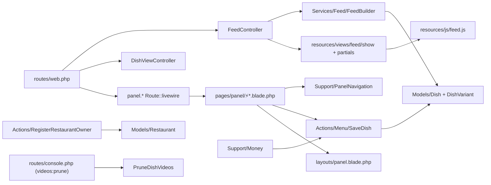
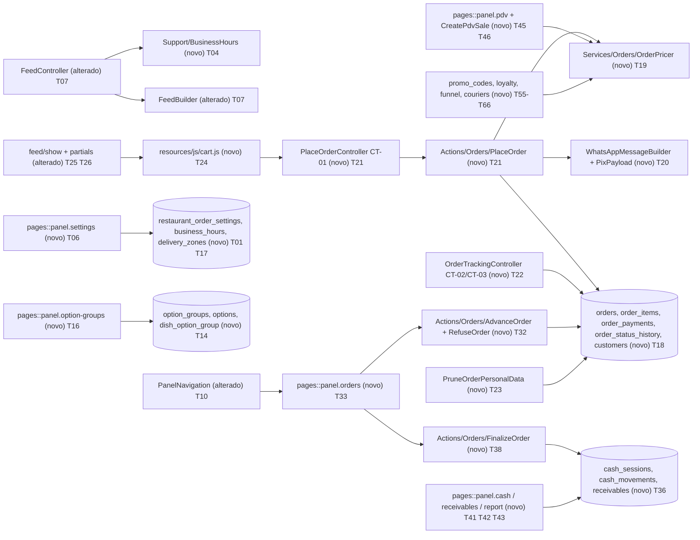

# Implementation Plan

## Request Summary
- Objective: transformar o Degusta (cardápio em vídeo somente de visualização) em cardápio + pedidos + entrega + caixa, seguindo as fases 0 a 7 de `Docs/planejamento-pedidos-e-caixa.md` (seção 7), sem regredir o existente (RF-25).
- Scope: in = RF-01 a RF-25, UI-01 a UI-04, CT-01 a CT-06, RNF-01 a RNF-09; out = pagamento online, API oficial do WhatsApp, billing da plataforma / tabela `coupons`, feed em Livewire.
- Tier: complete
- Architecture references: `docs/agents/architecture.md`, `docs/agents/domain_rules.md`, `docs/agents/coding_guidelines.md`, `docs/agents/data_model.md`, `docs/agents/api_contracts.md`, `docs/agents/tech_stack.md` (`AGENTS.md` é só stub do Boost). Init chain `.spec/init/project-phases.md` consultado como auxiliar; a ordem aqui segue o planejamento seção 7.

### Regras de arquitetura que TODAS as tasks preservam (fonte: docs/agents)
1. `architecture.md` — camadas: controllers e páginas Livewire finos; sem lógica de persistência em Livewire/controller; regra de negócio em `app/Actions/<Área>/<Verbo>.php` com um único `handle()`; cálculos/montagem em `app/Services/*` e `app/Support/*`; modelos só com relações/escopos.
2. `architecture.md` + README — o feed `/r/{slug}` é Blade + JS puro, SEM Livewire; carrinho em `resources/js` (JS puro, `localStorage` por loja); painel em Livewire single-file (`resources/views/pages/panel/⚡*.blade.php`, rota `Route::livewire(..., 'pages::panel.x')`) usando `components/ui`.
3. `coding_guidelines.md` §1 — toda mudança multi-linha em `DB::transaction`; saldos/contadores/caixa com `lockForUpdate()`.
4. `coding_guidelines.md` §2 — operações de dinheiro idempotentes por `reference` (ex.: `order_finalize:{id}`, `order_refund:{id}`, `courier_settlement:{id}`, `loyalty_stamp:{order}`, `coupon_use:{order}`); checar existência antes de gravar.
5. `coding_guidelines.md` §3 + RNF-03 — status, formas de pagamento e tipos de movimento são tabelas lookup com `IsLookupTable` + `LookupSeeder`, resolvidas por slug (`OrderStatus::idFor('novo')`), registradas em `ReferenceDataSeeder`; testes chamam `seedReferenceData()`.
6. `coding_guidelines.md` §5/§6 — `#[Fillable([...])]` nos modelos; docblock com referência RF/US; testes Pest com `RefreshDatabase`, um arquivo de feature por área, executados via `./vendor/bin/sail artisan test` (host PHP não tem `intl`); `./vendor/bin/sail pint` em arquivos tocados.
7. `api_contracts.md` — sem `routes/api.php`; tudo em `routes/web.php`; endpoints públicos com `throttle`; painel sob `auth, auth.session, owner, verified.owner` e nomes `panel.*`; rotas existentes (listadas em api_contracts) devem seguir respondendo.
8. `architecture.md` / `api_contracts.md` — worker `queue:work --tries=1` sem retry: NENHUMA regra de dinheiro/selo/cupom depende de job; tudo síncrono e idempotente na requisição. Nenhum job novo é necessário; se algum for criado, escalar id escalar e reiniciar `./vendor/bin/sail restart queue` após mexer em PHP.
9. `domain_rules.md` — preservar `FeedBuilder::eligibleDishes` (visible + vídeo `aprovado` + categoria visível), `Restaurant::canAddDish()` e o padrão de retenção de `videos:prune` (comandos novos seguem `PruneDishVideos`: constantes nomeadas, `Schedule::command(...)->dailyAt(...)->onOneServer()` em `routes/console.php`).
10. `data_model.md` — migrations novas respeitam ordem de FKs do MySQL 8.4; `restaurant_id` em todo dado novo (RNF-01); dinheiro `decimal(10,2)` + `App\Support\Money`; app em UTC, conversão por fuso da loja só na apresentação e nas regras de horário (RNF-09).
11. `tech_stack.md` — Laravel 13 / Livewire 4 / Pest / Vite; novos JS entram pelo pipeline Vite existente (`resources/js/feed.js`, `app.js`).

## AS IS — Componentes impactados

Hoje o feed lê pratos via `FeedBuilder`, o painel (8 itens em `PanelNavigation`) delega a `app/Actions/*`, e não existe pedido, horário, entrega ou caixa. Verificado: nenhuma das rotas novas de CT-01 a CT-06 existe em `routes/web.php`; `/privacidade` JÁ existe (`legal.privacy`, `Route::view`) e será estendida, não duplicada; `bootstrap/app.php` já isenta de CSRF `r/*/visualizacoes`.

## TO BE — Componentes propostos

Nós novos por task: configurações/horário T01 a T11; complementos T14 a T16; entrega T17; pedido, preço e CT-01 a CT-03 T18 a T23; carrinho no feed T24 a T26; gestor T31 a T35; caixa/fiado/relatório T36 a T44; PDV T45 a T47; pizza/kg/promo T48 a T54; cupons, fidelidade, clientes, origem, funil T55 a T63; motoboys, comanda, distância, PWA, guia, ajuda, estilos, landing, docs T64 a T75.

## Fechamento de colisão de rotas (CT-01 e CT-06)

Verificado com Grep em `routes/web.php` e `routes/console.php`: nenhum match para `pedidos`, `eventos`, `/p/`, `entregador`, `configuracoes`, `complementos`, `caixa`, `pdv`, `fiado`, `relatorio`, `clientes`, `cupons`, `fidelidade`, `motoboys`, `ajuda`. Caminhos e nomes finais (todos em `routes/web.php`):

| Contrato | Método + caminho | Nome | Destino | Observação |
|---|---|---|---|---|
| CT-01 | POST `/r/{restaurant:slug}/pedidos` | `feed.orders.store` | `Feed\OrderController@store` | dentro do grupo `r/{restaurant:slug}` `feed.`; `throttle:30,1`; CSRF isento (`r/*/pedidos`) como `visualizacoes` |
| CT-02 | POST `/r/{restaurant:slug}/pedidos/{token}/whatsapp` | `feed.orders.whatsapp` | `Feed\OrderController@whatsapp` | 204; CSRF isento |
| CT-03 | GET `/p/{token}` e `/p/{token}/status` | `order.track`, `order.track.status` | `Feed\OrderTrackingController` | prefixo `/p` livre; 404 se expirado |
| CT-04 | POST `/r/{restaurant:slug}/eventos` | `feed.events` | `Feed\FunnelEventController` | 204; `throttle:120,1`; CSRF isento |
| CT-05 | GET `/entregador/{token}` | `courier.show` | `CourierLinkController` | 404 se revogado |
| CT-06 | `/painel/configuracoes` | `panel.settings` | `pages::panel.settings` | |
| CT-06 | `/painel/complementos` | `panel.option-groups` | `pages::panel.option-groups` | |
| CT-06 | `/painel/pedidos` | `panel.orders` | `pages::panel.orders` | |
| CT-06 | `/painel/caixa` | `panel.cash` | `pages::panel.cash` | |
| CT-06 | `/painel/pdv` | `panel.pdv` | `pages::panel.pdv` | |
| CT-06 | `/painel/fiado` | `panel.receivables` | `pages::panel.receivables` | |
| CT-06 | `/painel/relatorio` | `panel.report` | `pages::panel.report` | |
| CT-06 | `/painel/clientes` | `panel.customers` | `pages::panel.customers` | |
| CT-06 | `/painel/cupons` | `panel.promo-codes` | `pages::panel.promo-codes` | |
| CT-06 | `/painel/fidelidade` | `panel.loyalty` | `pages::panel.loyalty` | |
| CT-06 | `/painel/motoboys` | `panel.couriers` | `pages::panel.couriers` | |
| CT-06 | `/painel/ajuda` | `panel.help` | `pages::panel.help` | |
| RF-06f | GET `/privacidade?loja={slug}` | `legal.privacy` (existente) | controller novo substitui `Route::view` mantendo nome/caminho | sem rota nova |

Colisões tratadas: (a) `/painel/pratos*` e nomes `panel.dishes*` NÃO mudam; (b) `r/{restaurant:slug}/categorias/{category}` e `/pedidos` não conflitam (segmentos distintos); (c) `/p/{token}` não conflita com `/painel` nem `/privacidade`; (d) rotas CT-06 são registradas dentro do grupo `painel` existente (`panel.` prefix) sem sobrepor `/painel/{...}` genérico (o grupo só tem segmentos literais). O teste automatizado de colisão é a T12 (e reexecutado em cada closure).

## Tasks

### T01 — Schema de configurações do pedido e horários (Fase 0)
- **Files**: `database/migrations/2026_11_01_000001_create_restaurant_order_settings_and_business_hours_tables.php`, `app/Models/RestaurantOrderSetting.php`, `app/Models/BusinessHour.php`, `database/factories/RestaurantOrderSettingFactory.php`, `database/factories/BusinessHourFactory.php`, `app/Models/Restaurant.php`
- **Change**: criar `restaurant_order_settings` (restaurant_id único, whatsapp_number, address, pix_key/holder/city, accepts_orders manual, hours_enabled, accepts_when_closed, timezone default `America/Porto_Velho`, delivery_mode, free_delivery_over, min_order_delivery, pizza_pricing_rule, lat, lng; dinheiro decimal(10,2)) e `business_hours` (restaurant_id, weekday, shift, opens_at, closes_at, único por restaurante/dia/turno); relações `Restaurant::orderSetting()`/`businessHours()`; `#[Fillable]`.
- **Covers**: RF-01, RF-02, RF-02e, RNF-01, RNF-02, RNF-09
- **Tests**: `tests/Feature/OrderSettingsSchemaTest.php` — persistência, unicidade por loja, `config('app.timezone')` segue `UTC`
- **Risk**: Low — tabelas novas, aditivas
- **Dependencies**: none

### T02 — Colunas de categoria (ícone/janela) e tipo de negócio
- **Files**: `database/migrations/2026_11_01_000002_add_icon_window_to_categories_and_business_type_to_restaurants.php`, `app/Models/Category.php`, `app/Models/Restaurant.php`
- **Change**: `categories.icon` (string null), `shows_from`/`shows_until` (time null); `restaurants.business_type` (string null); atualizar `#[Fillable]`; helper `Category::isShownAt(CarbonInterface $localTime)` tratando janela que vira meia-noite.
- **Covers**: RF-02b, RF-02c
- **Tests**: `tests/Unit/CategoryWindowTest.php` — 11:00-15:00 oculta às 16:00, mostra às 12:00; janela 22:00-02:00
- **Risk**: Low
- **Dependencies**: none

### T03 — Flags de funcionalidade por plano
- **Files**: `database/migrations/2026_11_01_000003_add_features_to_plans_table.php`, `config/plan_features.php`, `app/Models/Plan.php`, `database/seeders/PlanSeeder.php`, `app/Http/Middleware/EnsurePlanFeature.php`, `bootstrap/app.php`
- **Change**: `plans.features` JSON; `config/plan_features.php` lista chaves (orders, cash, pdv, loyalty, couriers, stats_advanced...) com default ligado em todos os planos (decisão: pedidos em todos); `Plan::hasFeature(string)`; middleware alias `plan.feature:<chave>` retornando 403 ao desligado; PlanSeeder preenche. `metrics_level` continua sendo o gate de estatísticas (RF-21).
- **Covers**: RF-02d, RF-21 (base)
- **Tests**: `tests/Feature/PlanFeatureGateTest.php` — rota protegida retorna 403 com feature off, 200 com on; seeders preservam planos existentes
- **Risk**: Medium — altera PlanSeeder e Filament PlansTable não deve quebrar; rodar `PlanSeederTest`
- **Dependencies**: none

### T04 — Support/BusinessHours (estado aberto/fechado no fuso da loja)
- **Files**: `app/Support/BusinessHours.php`, `tests/Unit/BusinessHoursTest.php`
- **Change**: `BusinessHours::state(Restaurant $r, ?CarbonInterface $now): array{open: bool, reason, next_opening: ?CarbonImmutable, label}`; converte UTC→fuso da loja; múltiplos turnos, virada de meia-noite, interruptor manual `accepts_orders` prevalece (fechado), `hours_enabled=false` ⇒ só manual; rótulos "Aberto agora" / "Fechado · abre às 18:00"; `weekGrid()` para "Ver horários".
- **Covers**: RF-02, RF-02a (base), RF-02e, RNF-09, UI-04
- **Tests**: `tests/Unit/BusinessHoursTest.php` — seg 18-23: 22:30 UTC seg = aberto; 03:30 UTC ter = fechado; seg 12:00 = "abre às 18:00"; manual fechado; turno 22:00-02:00; fuso inválido lança
- **Risk**: Medium — erro de fuso afeta caixa/relatório; cobrir DST-free (Porto_Velho sem DST) e outro fuso
- **Dependencies**: T01

### T05 — Actions de configurações, horários e policy
- **Files**: `app/Actions/Settings/SaveOrderSettings.php`, `app/Actions/Settings/SaveBusinessHours.php`, `app/Policies/RestaurantOrderSettingPolicy.php`, `app/Providers/AppServiceProvider.php`
- **Change**: `handle()` valida/normaliza WhatsApp (somente dígitos, 10-13, prefixo 55), valida fuso com `timezone_identifiers_list`, Pix, `Money::parse` nos valores; salva em `DB::transaction`; horários substituem os turnos do dia atomicamente; policy por `restaurant_id` (RNF-01).
- **Covers**: RF-01, RF-02, RF-02e, RNF-01
- **Tests**: `tests/Feature/SaveOrderSettingsTest.php` — número inválido rejeitado, fuso inválido rejeitado, reabrir mostra valores, dono B não altera loja A
- **Risk**: Low
- **Dependencies**: T01

### T06 — Tela Configurações (`/painel/configuracoes`)
- **Files**: `resources/views/pages/panel/⚡settings.blade.php`, `routes/web.php`
- **Change**: página Livewire fina que delega a T05; seções Loja (WhatsApp, endereço, "Testar este número" gera `https://wa.me/<n>?text=...` sem criar pedido, aberto/fechado manual, fuso), Horários (turnos por dia), Pix, modo "aceitar pedido fechado"; rota `panel.settings`; usa `components/ui`.
- **Covers**: RF-01, RF-02, RF-02e, UI-01
- **Tests**: `tests/Feature/PanelSettingsPageTest.php` — `Livewire::test` salva/reabre, link wa.me, nenhum registro em `orders`
- **Risk**: Low
- **Dependencies**: T05, T04

### T07 — Feed: estado aberto/fechado, "Ver horários" e janela de categoria
- **Files**: `app/Http/Controllers/Feed/FeedController.php`, `app/Services/Feed/FeedBuilder.php`, `resources/views/feed/show.blade.php`, `resources/views/feed/partials/category-bar.blade.php`, `app/Support/FeedSample.php`
- **Change**: passar `BusinessHours::state` ao Blade; faixa "Aberto agora"/"Fechado · abre às X" e sheet "Ver horários" (HTML estático, sem Livewire, sem JS pesado); `FeedBuilder` filtra categorias fora da janela (RF-02b) preservando `eligibleDishes`; ícone na barra de categoria; `FeedSample` ganha os novos campos para `/dev/feed` e preview de Aparência.
- **Covers**: RF-02, RF-02b, RF-25, RNF-06
- **Tests**: `tests/Feature/FeedOpenStateTest.php` — "Aberto agora", "Fechado · abre às 18:00", manual fechado; categoria 11-15 some às 16:00; `FeedShellTest`/`FeedGridTest` seguem verdes
- **Risk**: Medium — feed é caminho crítico; rodar testes Feed* existentes
- **Dependencies**: T02, T04

### T08 — Aviso de loja fechada no painel
- **Files**: `resources/views/components/store-status-banner.blade.php`, `resources/views/layouts/panel.blade.php`, `resources/views/pages/panel/⚡home.blade.php`
- **Change**: componente que mostra estado atual e próximo horário (via `BusinessHours`) destacado quando fechado; incluir no layout do painel e em Início.
- **Covers**: UI-04, RF-02
- **Tests**: `tests/Feature/PanelClosedBannerTest.php` — aviso visível quando fechado, ausente quando aberto
- **Risk**: Low
- **Dependencies**: T04

### T09 — Tipo de negócio no cadastro e categorias iniciais
- **Files**: `config/business_types.php`, `app/Actions/RegisterRestaurantOwner.php`, `resources/views/pages/auth/⚡register.blade.php`
- **Change**: `config/business_types.php` com 5 tipos e categorias iniciais; campo opcional no cadastro; `RegisterRestaurantOwner` cria categorias na mesma transação; sem escolha ⇒ nenhuma.
- **Covers**: RF-02c
- **Tests**: `tests/Feature/RegisterBusinessTypeTest.php` — pizzaria cria ≥1 categoria do conjunto; sem escolha, zero categorias; `RegisterTest` existente verde
- **Risk**: Low
- **Dependencies**: T02

### T10 — Menu agrupado, rótulo "Produtos" e gate por plano
- **Files**: `app/Support/PanelNavigation.php`, `resources/views/layouts/panel.blade.php`, `resources/views/pages/panel/⚡dishes.blade.php`, `resources/views/pages/panel/⚡home.blade.php`, `resources/views/pages/panel/⚡subscription.blade.php`, `routes/web.php`
- **Change**: `PanelNavigation::groups()` com exatamente Cardápio, Pedidos, Financeiro, Divulgação, Conta (itens futuros listados e desabilitados enquanto a rota não existir, padrão `Route::has` já existente); trocar "Pratos" por "Produtos" no painel (`dishes.blade`, `home.blade`, `subscription.blade`, nav) sem mexer em nomes de rota `panel.dishes*` nem em `app/Filament` (admin); itens respeitam `Plan::hasFeature`.
- **Covers**: RF-02d, UI-01, RF-25
- **Tests**: `tests/Feature/PanelNavigationTest.php` — 5 grupos exatos; nenhuma tela do painel contém "Pratos"; `/painel/pratos`, `/pratos/novo` respondem 200; `PanelShellTest` verde
- **Risk**: Medium — PanelShell/Dish tests dependem de rótulos; atualizar asserts existentes
- **Dependencies**: T03

### T11 — Categorias: ícone e horário próprio no painel
- **Files**: `resources/views/pages/panel/⚡categories.blade.php`, `app/Actions/Menu/SaveCategory.php`
- **Change**: campos ícone + "Mostrar só em um horário" (de/até); `SaveCategory` (novo Action) valida e persiste; página só delega.
- **Covers**: RF-02b, UI-01
- **Tests**: `tests/Feature/CategoryManagementTest.php` (estender) — salvar janela/ícone; reabrir mostra os valores
- **Risk**: Low
- **Dependencies**: T02

### T12 — Fechamento Fase 0: colisão de rotas e regressão
- **Files**: `tests/Feature/RouteCollisionTest.php`
- **Change**: teste que percorre `Route::getRoutes()` garantindo nomes e `método+uri` únicos, e que as rotas listadas em `api_contracts.md` seguem respondendo; asserts reaproveitados nas closures seguintes; rodar `./vendor/bin/sail artisan test`.
- **Covers**: RF-25, CT-06, CT-01
- **Tests**: `tests/Feature/RouteCollisionTest.php` — sem duplicata; suíte completa verde
- **Risk**: Low
- **Dependencies**: T06, T07, T08, T09, T10, T11

### T13 — Tabelas lookup de pedido e pagamento
- **Files**: `database/migrations/2026_11_02_000001_create_order_statuses_and_payment_methods_tables.php`, `app/Models/OrderStatus.php`, `app/Models/PaymentMethod.php`, `database/seeders/OrderStatusSeeder.php`, `database/seeders/PaymentMethodSeeder.php`, `database/seeders/ReferenceDataSeeder.php`, `tests/Feature/LookupSeedersTest.php`
- **Change**: lookups com `IsLookupTable` + `LookupSeeder`: `order_statuses` (novo, aceito, em_preparo, pronto_em_rota, finalizado, recusado, cancelado) e `payment_methods` (pix, dinheiro, cartao, fiado); registrar no `ReferenceDataSeeder`.
- **Covers**: RNF-03
- **Tests**: `LookupSeedersTest` — slugs presentes, `idFor()` resolve
- **Risk**: Low
- **Dependencies**: none

### T14 — Schema de complementos e 9 modelos prontos
- **Files**: `database/migrations/2026_11_02_000002_create_option_groups_options_and_dish_option_group_tables.php`, `app/Models/OptionGroup.php`, `app/Models/Option.php`, `app/Models/Dish.php`, `database/factories/OptionGroupFactory.php`, `config/option_group_templates.php`
- **Change**: `option_groups` (mode one|many, max_choices, is_required, allow_repeat, display_order, is_active), `options` (price nullable, is_available), `dish_option_group` (pivot com display_order); `Dish::optionGroups()`; `config/option_group_templates.php` com os 9 modelos (Tamanhos, Adicionais, Bordas, Bebida do combo, Molhos, Ponto da carne, Tipo de corte, Açaí, do zero); `dish_variants` intactos.
- **Covers**: RF-03, RNF-01, RNF-02
- **Tests**: `tests/Feature/OptionGroupSchemaTest.php` — 9 templates; relação dish↔grupos; escopo por loja
- **Risk**: Low
- **Dependencies**: none

### T15 — SyncDishOptionGroups e vínculo no formulário de produto
- **Files**: `app/Actions/Menu/SyncDishOptionGroups.php`, `app/Actions/Menu/SaveDish.php`, `resources/views/pages/panel/⚡dish-form.blade.php`
- **Change**: Action sincroniza grupos (apenas da própria loja) dentro da mesma transação de `SaveDish`, inclusive na criação; seletor de grupos no form. Corrige a armadilha "complemento ao criar não persistiu".
- **Covers**: RF-03, RNF-01
- **Tests**: `tests/Feature/DishOptionGroupsTest.php` — criar produto com 2 grupos e reabrir devolve 2; grupo de outra loja rejeitado; `DishManagementTest` verde
- **Risk**: Medium — toca `SaveDish`/`dish-form` (arquivos compartilhados; não paralelizar com T28/T49)
- **Dependencies**: T14

### T16 — Tela Complementos (`/painel/complementos`)
- **Files**: `resources/views/pages/panel/⚡option-groups.blade.php`, `app/Actions/Menu/SaveOptionGroup.php`, `app/Actions/Menu/DeleteOptionGroup.php`, `routes/web.php`
- **Change**: CRUD de grupos/opções, aplicar modelo pronto, prévia ao vivo "como o cliente vê"; rota `panel.option-groups`; entrada no menu (grupo Cardápio).
- **Covers**: RF-03, UI-01
- **Tests**: `tests/Feature/OptionGroupsPageTest.php` — criar a partir de modelo, editar, isolar entre lojas
- **Risk**: Low
- **Dependencies**: T14, T10

### T17 — Bairros de entrega (delivery_zones)
- **Files**: `database/migrations/2026_11_02_000003_create_delivery_zones_table.php`, `app/Models/DeliveryZone.php`, `app/Actions/Settings/SaveDeliveryZones.php`, `resources/views/pages/panel/⚡settings.blade.php`
- **Change**: tabela e Action; seção "Entrega" na tela de Configurações (modo, bairros e taxa, frete grátis acima de X, pedido mínimo para entrega, "outro bairro = a combinar").
- **Covers**: RF-06b, RNF-01, RNF-02
- **Tests**: `tests/Feature/DeliveryZonesTest.php` — salvar/ler, valores via `Money::parse`
- **Risk**: Low
- **Dependencies**: T06

### T18 — Schema de pedidos
- **Files**: `database/migrations/2026_11_02_000004_create_orders_tables.php`, `app/Models/Order.php`, `app/Models/OrderItem.php`, `app/Models/OrderPayment.php`, `app/Models/OrderStatusHistory.php`, `app/Models/Customer.php`, `database/factories/OrderFactory.php`
- **Change**: `orders` (índice único `restaurant_id+code`, `tracking_token` único, status_id FK, fulfillment, channel, origin, endereço, delivery_fee/subtotal/discount/total decimal, payment_method_id, change_for, notes, `is_after_hours`, `whatsapp_opened_at`, `customer_confirmed_at`, accepted/dispatched/finished/cancelled_at, `cancel_reason`, `purged_at`, courier_id/promo_code_id/cash_session_id nullable sem FK ainda), `order_items` (snapshot + selections JSON), `order_payments`, `order_status_history`, `customers`; nenhuma FK para tabelas ainda inexistentes (FKs adicionadas nas migrations posteriores).
- **Covers**: RF-06, RF-02a, RF-07a, RNF-01, RNF-02
- **Tests**: `tests/Feature/OrderSchemaTest.php` — unicidade code/loja, snapshot imune a edição do produto
- **Risk**: Medium — migração grande; ordem de FKs no MySQL 8.4
- **Dependencies**: T13

### T19 — Services/Orders/OrderPricer
- **Files**: `app/Services/Orders/OrderPricer.php`, `app/Services/Orders/PricedOrder.php`, `app/Exceptions/OrderRejectedException.php`
- **Change**: recalcula do banco: produto, variação, complementos (obrigatório, máximo, repetição, indisponível), quantidade, taxa por bairro/"a combinar", frete grátis e mínimo sobre subtotal ANTES de desconto, rejeita item inexistente/indisponível/oculto/de outra loja/fora do horário da categoria listando cada item; valores do navegador ignorados; só `Money`/centavos inteiros, nunca float; ganchos para desconto (Fase 6), pizza/kg/promo (Fase 5), distância (Fase 7).
- **Covers**: RF-05, RF-06b, RF-06e, RNF-02
- **Tests**: `tests/Unit/OrderPricerTest.php` — preço adulterado ignorado; complemento obrigatório ausente; mínimo/frete grátis; item de outra loja; bairro fora da lista ⇒ taxa pendente
- **Risk**: High — núcleo financeiro; reutilizado por PDV/pizza/kg
- **Dependencies**: T14, T17, T18

### T20 — Código do pedido, token, mensagem de WhatsApp e payload Pix
- **Files**: `app/Services/Orders/OrderCodeGenerator.php`, `app/Services/Orders/WhatsAppMessageBuilder.php`, `app/Support/PixPayload.php`, `tests/Unit/WhatsAppMessageBuilderTest.php`, `tests/Unit/PixPayloadTest.php`
- **Change**: código `D-XXXXX` (5 chars sem ambíguos) com retry em colisão do índice único; `tracking_token` aleatório 40+ chars; mensagem com itens, escolhas, subtotal, taxa, total, recebimento, pagamento/troco, endereço, ícone de categoria e link `/p/{token}`; Pix copia-e-cola EMV com valor do servidor (chave/titular/cidade das configurações).
- **Covers**: RF-06, RF-06c, RF-02b
- **Tests**: unit — mensagem contém link; payload contém valor total e CRC válido
- **Risk**: Medium — CRC16 do Pix; validar com vetor conhecido
- **Dependencies**: T18

### T21 — PlaceOrder + CT-01
- **Files**: `app/Actions/Orders/PlaceOrder.php`, `app/Http/Requests/Feed/PlaceOrderRequest.php`, `app/Http/Controllers/Feed/OrderController.php`, `routes/web.php`, `bootstrap/app.php`
- **Change**: `PlaceOrder::handle()` em `DB::transaction`: checa loja suspensa (403), loja fechada sem `accepts_when_closed` (422), chama `OrderPricer`, valida troco ≥ total, upsert de `customers`, grava pedido (status `novo`, selo `is_after_hours`), itens snapshot, history inicial, monta mensagem e payload Pix; controller fino devolve 201 `{code, tracking_token, whatsapp_message, whatsapp_url, tracking_url, pix_payload?}` (campo `pix_payload` aditivo — ver Open Questions); 422 identifica cada item indisponível; rota `feed.orders.store` com `throttle:30,1`; isentar CSRF `r/*/pedidos` e `r/*/pedidos/*/whatsapp` em `bootstrap/app.php`. Pix NÃO cria `order_payments`/movimento.
- **Covers**: RF-02a, RF-05, RF-06, RF-06b, RF-06c, RF-06e, CT-01, RNF-04, RNF-05
- **Tests**: `tests/Feature/PlaceOrderTest.php` — 201 feliz; 422 fechado; 201 com opção + selo; preço adulterado; item oculto 422 com lista; remover item ⇒ 201; troco menor rejeitado; 403 suspensa; Pix sem `order_payments`; 30 itens < 800 ms (asserção de tempo tolerante)
- **Risk**: High — endpoint público, CSRF isento, dinheiro; limitar tamanho do payload (≤ 60 itens)
- **Dependencies**: T19, T20, T04, T13

### T22 — CT-02 e CT-03 (WhatsApp aberto/confirmado e acompanhamento)
- **Files**: `app/Http/Controllers/Feed/OrderController.php`, `app/Http/Controllers/Feed/OrderTrackingController.php`, `app/Actions/Orders/RecordWhatsAppEvent.php`, `resources/views/order/track.blade.php`, `resources/js/track.js`, `routes/web.php`
- **Change**: POST `feed.orders.whatsapp` (grava `whatsapp_opened_at`/`customer_confirmed_at` conforme corpo, token precisa pertencer à loja, 204, throttle); GET `/p/{token}` (Blade, tema da loja, linha do tempo com horário de cada etapa, "Falar com a loja", "Ver cardápio") e GET `/p/{token}/status` JSON; polling vanilla a cada 10 s; exibe só primeiro nome e bairro+rua; 404 se token inexistente ou encerrado há mais de 7 dias (a partir de finished/refused/cancelled).
- **Covers**: RF-06a, RF-07, RF-07a, CT-02, CT-03, UI-02
- **Tests**: `tests/Feature/OrderTrackingTest.php` — HTML e JSON sem sobrenome/WhatsApp/número/observações; 6 dias = 200, 8 dias = 404; token de outro pedido não vaza; `RecordWhatsAppEvent` timestamps nulos até o evento
- **Risk**: Medium — vazamento de PII em URL enviada por WhatsApp
- **Dependencies**: T21

### T23 — Expurgo de endereço/observações (RNF-08)
- **Files**: `app/Console/Commands/PruneOrderPersonalData.php`, `app/Actions/Orders/PurgeOrderPersonalData.php`, `routes/console.php`
- **Change**: comando `orders:prune-personal-data` (padrão `PruneDishVideos`, constante `RETENTION_DAYS = 30`) nulifica endereço e observações de pedidos encerrados há mais de 30 dias, marca `purged_at`; idempotente; agendado `dailyAt('04:30')->onOneServer()`; views do gestor/comanda/relatório tratam endereço nulo.
- **Covers**: RNF-08, RF-07a
- **Tests**: `tests/Feature/PruneOrderPersonalDataTest.php` — 31 dias limpa, 29 mantém, aberto intocado, duas execuções inofensivas, nome/WhatsApp/valores permanecem
- **Risk**: Low
- **Dependencies**: T18

### T24 — Carrinho em JS puro (`resources/js/cart.js`)
- **Files**: `resources/js/cart.js`, `resources/js/feed.js`, `vite.config.js`
- **Change**: módulo sem dependências: estado por loja em `localStorage` (`degusta:cart:{slug}`), regras de escolha (obrigatório, máximo, repetição), observação ≤ 140, subtotal apenas informativo; carregado como chunk separado importado por `feed.js`; sem Livewire/Alpine no feed.
- **Covers**: RF-04, RNF-06
- **Tests**: `tests/Feature/FeedCartAssetsTest.php` — feed não inclui Livewire; teste de tamanho (script `gzip -c public/build/assets/cart-*.js | wc -c` ≤ 30 KB documentado na T30)
- **Risk**: Medium — peso do JS inicial
- **Dependencies**: T14

### T25 — Feed: botão adicionar, ficha com escolhas, barra e sheet do carrinho
- **Files**: `resources/views/feed/partials/dish.blade.php`, `resources/views/feed/partials/detail-sheet.blade.php`, `resources/views/feed/partials/cart-bar.blade.php`, `resources/views/feed/partials/cart-sheet.blade.php`, `resources/views/feed/show.blade.php`, `app/Services/Feed/FeedBuilder.php`
- **Change**: expor grupos/opções/variações como JSON no feed; botão "Adicionar" no vídeo e na ficha; bloqueio de adicionar sem grupo obrigatório; barra fixa "Ver pedido · N itens · R$ total" e bottom sheet (editar/remover) em estilo de vidro herdando cor/fonte; esconder adição de produto indisponível/fora da janela; aviso "Catálogo em preparação" com WhatsApp quando não há produtos.
- **Covers**: RF-04, RF-06e, UI-02, RF-25
- **Tests**: `tests/Feature/FeedOrderingMarkupTest.php` — markup contém botão e dados dos grupos; produto esgotado sem botão; feed sem `livewire`
- **Risk**: Medium — arquivos de feed compartilhados com T07; `FeedBuilder` tocado de novo
- **Dependencies**: T24, T07

### T26 — Checkout em etapas
- **Files**: `resources/views/feed/partials/checkout.blade.php`, `resources/js/checkout.js`, `resources/js/cart.js`, `resources/views/feed/show.blade.php`
- **Change**: etapas receber → endereço (bairro com taxa, "a combinar", "faltam R$ X para entrega grátis") → pagamento (Pix com copia-e-cola vindo do servidor, dinheiro com troco, cartão) → observação; envia CT-01 e mostra erros 422 por item; abre `wa.me`, grava `customer_confirmed_at` via CT-02 após "Sim, enviei"; nome/WhatsApp/endereço no `localStorage` com aviso de privacidade; "Fazer outro pedido"; usável em 360 px.
- **Covers**: RF-06b, RF-06c, RF-06d, RF-06a, UI-02
- **Tests**: `tests/Feature/FeedCheckoutMarkupTest.php` — partial presente, zonas serializadas; fluxo ponta a ponta no navegador conferido manualmente e na T30
- **Risk**: High — UX crítica em celular fraco; mensagem WhatsApp vem do servidor
- **Dependencies**: T25, T21, T22

### T27 — Actions da lista de produtos
- **Files**: `app/Actions/Menu/UpdateDishPrice.php`, `app/Actions/Menu/DuplicateDish.php`, `app/Actions/Menu/DeleteDish.php`, `app/Actions/Menu/SetDishFlag.php`
- **Change**: preço via `Money::parse` ("R$ 32,90", "32,90", "3290"); duplicar respeita `Restaurant::canAddDish()` (copia variantes e grupos, sem vídeo); excluir; interruptores disponível (`esgotado`) e visível (`oculto`) usando `DishStatus`.
- **Covers**: RF-06f, RNF-01, RF-25
- **Tests**: `tests/Feature/DishQuickActionsTest.php` — três formatos de preço; duplicar bloqueado no limite do plano; isolamento entre lojas
- **Risk**: Medium
- **Dependencies**: T14

### T28 — Lista de produtos (UI)
- **Files**: `resources/views/pages/panel/⚡dishes.blade.php`
- **Change**: busca, filtro por categoria, abas Todos/Ativos/Indisponíveis/Ocultos, edição de preço na linha, interruptores, duplicar e excluir delegando a T27.
- **Covers**: RF-06f, UI-01
- **Tests**: `tests/Feature/DishManagementTest.php` e `DishAvailabilityTest.php` (estender)
- **Risk**: Medium — arquivo compartilhado com T10/T54
- **Dependencies**: T27, T10

### T29 — Política de privacidade por loja
- **Files**: `app/Http/Controllers/PrivacyController.php`, `resources/views/marketing/legal/privacy.blade.php`, `routes/web.php`
- **Change**: substituir `Route::view('/privacidade', ...)` por controller que aceita `?loja={slug}` e acrescenta bloco da loja (retenção de 30 dias / 2 anos), mantendo nome `legal.privacy` e a página geral sem o parâmetro; link no checkout.
- **Covers**: RF-06f, RNF-08
- **Tests**: `tests/Feature/PrivacyPageTest.php` — com e sem `loja`; slug inexistente cai na geral
- **Risk**: Low
- **Dependencies**: none

### T30 — Fechamento Fase 1: fluxo ponta a ponta, peso do JS, regressão
- **Files**: `tests/Feature/OrderCheckoutFlowTest.php`
- **Change**: teste de fluxo (feed → CT-01 → CT-02 → CT-03) cobrindo RF-02a/05/06/06e/07a; medir gzip do JS novo (≤ 30 KB); conferência manual no celular; `RouteCollisionTest` e suíte completa; `./vendor/bin/sail restart queue`.
- **Covers**: RF-25, RNF-05, RNF-06, RNF-07
- **Tests**: `tests/Feature/OrderCheckoutFlowTest.php`, suíte completa
- **Risk**: Medium
- **Dependencies**: T15, T16, T23, T26, T28, T29

### T31 — Support/StorePeriod (hoje/ontem/7 dias/mês/mês passado)
- **Files**: `app/Support/StorePeriod.php`, `tests/Unit/StorePeriodTest.php`
- **Change**: `StorePeriod::range(string $key, Restaurant $r): array{start: UTC, end: UTC}` no fuso da loja; usado por gestor e relatório.
- **Covers**: RNF-09, RF-08b, RF-12
- **Tests**: pedido 02:00 UTC de terça cai em "hoje" de segunda no fuso Porto_Velho
- **Risk**: Medium — fuso
- **Dependencies**: T01

### T32 — Policy e Actions de transição de pedido
- **Files**: `app/Policies/OrderPolicy.php`, `app/Actions/Orders/AdvanceOrder.php`, `app/Actions/Orders/RefuseOrder.php`, `app/Actions/Orders/AcceptOrder.php`, `app/Services/Orders/OrderTransitions.php`, `app/Providers/AppServiceProvider.php`
- **Change**: mapa de transições (novo→aceito|recusado; aceito→em_preparo; em_preparo→pronto_em_rota; pronto_em_rota→finalizado*; finalizado→cancelado via T39; recusado/cancelado terminais); cada transição em `DB::transaction` com `lockForUpdate()` no pedido, grava `order_status_history` e timestamps; `AcceptOrder` exige taxa quando "a combinar" e recalcula total; `finalizado` é delegado a `FinalizeOrder` (T38).
- **Covers**: RF-08, RNF-01, RNF-04
- **Tests**: `tests/Feature/OrderTransitionsTest.php` — transições inválidas rejeitadas, 1 história por transição, aceitar "a combinar" sem taxa falha, dono B recebe 403
- **Risk**: High — máquina de estados; testar concorrência (duplo clique)
- **Dependencies**: T18, T21

### T33 — Gestor de pedidos (`/painel/pedidos`)
- **Files**: `resources/views/pages/panel/⚡orders.blade.php`, `resources/views/pages/panel/partials/order-card.blade.php`, `routes/web.php`
- **Change**: 4 colunas (Novos, Em preparo, Pronto/Em rota, Finalizados), cartão com dados do pedido e selos ("WhatsApp abriu", "Cliente confirmou", "Cliente novo", "feito fora do horário"), busca, filtro hoje/ontem/7 dias via `StorePeriod`, soma do período, botões que delegam a T32; só pedidos da própria loja.
- **Covers**: RF-08, RF-08b, RF-02a, RF-06a, UI-01
- **Tests**: `tests/Feature/OrderManagerPageTest.php` — colunas, filtro, selos, 403/404 entre lojas
- **Risk**: Medium
- **Dependencies**: T32, T31, T10

### T34 — Tempo real, contador, som e avisos ao cliente
- **Files**: `resources/views/pages/panel/⚡orders.blade.php`, `app/Support/PanelNavigation.php`, `resources/views/layouts/panel.blade.php`, `resources/js/panel-sound.js`, `app/Services/Orders/CustomerNoticeBuilder.php`
- **Change**: `wire:poll.5s` no gestor; contador de pedidos `novo` no menu; botão "Ativar som" (liberação de autoplay) e som ao chegar pedido; mensagens prontas de WhatsApp por status (`CustomerNoticeBuilder`) e opção "abrir no WhatsApp Desktop" (esquema `whatsapp://send`) guardada por aparelho.
- **Covers**: RF-08, RF-08a, UI-03
- **Tests**: `tests/Feature/OrderManagerRealtimeTest.php` — pedido criado via CT-01 aparece no render seguinte; contador reflete `novo`; mensagens por status
- **Risk**: Medium — polling aumenta carga; usar consulta indexada
- **Dependencies**: T33

### T35 — Fechamento Fase 2
- **Files**: `tests/Feature/OrderTimelineTest.php`
- **Change**: mudança de status no gestor aparece em `/p/{token}/status` com horário; regressão completa e `RouteCollisionTest`.
- **Covers**: RF-07, RF-08, RF-25
- **Tests**: `tests/Feature/OrderTimelineTest.php`, suíte completa
- **Risk**: Low
- **Dependencies**: T34

### T36 — Schema de caixa, fiado e lookups financeiros
- **Files**: `database/migrations/2026_11_03_000001_create_cash_tables.php`, `app/Models/CashSession.php`, `app/Models/CashMovement.php`, `app/Models/CashMovementType.php`, `app/Models/Receivable.php`, `database/seeders/CashMovementTypeSeeder.php`, `database/seeders/ReferenceDataSeeder.php`
- **Change**: `cash_movement_types` (venda, despesa, retirada, reforco, estorno, recebimento_fiado) como lookup; `cash_sessions` (opening_float, counted_cash, expected_cash, closed_at, índice para impedir 2 abertos por loja via coluna `open_key` única nula ao fechar), `cash_movements` (`reference` único por loja), `receivables` (customer, name, phone, amount, paid_at, cancelled_at, order_id); FK `orders.cash_session_id`.
- **Covers**: RF-09, RF-10, RF-11, RNF-02, RNF-03, RNF-04
- **Tests**: `tests/Feature/CashSchemaTest.php` — 2 caixas abertos impossíveis; reference duplicada rejeitada
- **Risk**: Medium
- **Dependencies**: T18, T13

### T37 — Actions de caixa
- **Files**: `app/Actions/Cash/OpenCashSession.php`, `app/Actions/Cash/CloseCashSession.php`, `app/Actions/Cash/RecordMovement.php`, `app/Services/Cash/CashSummary.php`
- **Change**: abrir com troco inicial (falha se já aberto); `RecordMovement` idempotente por `reference` com `lockForUpdate()` da sessão; fechar compara contado × esperado (troco + vendas dinheiro + reforços − retiradas − despesas dinheiro − estornos dinheiro); Pix/cartão só listados à parte.
- **Covers**: RF-10, RNF-04
- **Tests**: `tests/Feature/CashSessionTest.php` — esperado correto, Pix/cartão fora do esperado, mesma reference duas vezes grava uma
- **Risk**: High — dinheiro
- **Dependencies**: T36

### T38 — FinalizeOrder e edição de pagamento
- **Files**: `app/Actions/Orders/FinalizeOrder.php`, `app/Actions/Orders/UpdateOrderPayment.php`, `app/Actions/Cash/CreateReceivable.php`
- **Change**: pagamento Pix (confirmado pelo dono), dinheiro (troco), cartão, fiado (cria `receivables` com nome e WhatsApp), dividido (soma = total), ou "sem registrar"; `DB::transaction` + `lockForUpdate()` do pedido; referência `order_finalize:{id}`; com caixa aberto cria `cash_movements` e vincula `cash_session_id`; delivery com caixa fechado finaliza, grava `order_payments`, sem movimento, retorna aviso; editar pagamento pós-finalização ajusta movimento por referência.
- **Covers**: RF-09, RF-06c, RNF-04
- **Tests**: `tests/Feature/FinalizeOrderTest.php` — dividido ≠ total falha; finalizar 2x não duplica; delivery caixa fechado: sucesso + aviso + zero movimentos; caixa aberto: 1 movimento; Pix só gera pagamento ao finalizar
- **Risk**: High — dinheiro/idempotência
- **Dependencies**: T37, T32

### T39 — CancelFinalizedOrder (estorno)
- **Files**: `app/Actions/Orders/CancelFinalizedOrder.php`, `app/Actions/Cash/CancelReceivable.php`
- **Change**: exige motivo; uma transação: histórico com motivo, movimento `estorno` (referência `order_refund:{id}`) sem apagar o original, cancela fiado não pago (fiado pago ⇒ registra estorno do valor pago), ponto de extensão `OrderCancellationSideEffects` para cupom (T55) e fidelidade (T57); idempotente.
- **Covers**: RF-08c, RNF-04
- **Tests**: `tests/Feature/CancelFinalizedOrderTest.php` — sem motivo rejeita; 1 estorno; duas vezes não duplica; fiado não pago cancelado; fiado pago preservado
- **Risk**: High
- **Dependencies**: T38

### T40 — Finalizar/cancelar no gestor (UI)
- **Files**: `resources/views/pages/panel/⚡orders.blade.php`, `resources/views/pages/panel/partials/finalize-modal.blade.php`
- **Change**: modal de pagamento (todas as formas, dividido, "sem registrar", troco calculado), aviso "sem lançamento no caixa", editar pagamento, cancelar com motivo.
- **Covers**: RF-09, RF-08c, UI-01
- **Tests**: `tests/Feature/OrderManagerFinalizeTest.php`
- **Risk**: Medium — arquivo compartilhado com T33/T34
- **Dependencies**: T38, T39

### T41 — Tela Caixa (`/painel/caixa`)
- **Files**: `resources/views/pages/panel/⚡cash.blade.php`, `routes/web.php`
- **Change**: abrir/fechar, despesa com categoria, retirada, reforço, "dinheiro na gaveta", vendas por forma, movimentos em ordem, diferença no fechamento; rota `panel.cash`; gate `plan.feature:cash`.
- **Covers**: RF-10, UI-01
- **Tests**: `tests/Feature/CashPageTest.php`
- **Risk**: Medium
- **Dependencies**: T37, T10

### T42 — Fiado (`/painel/fiado`)
- **Files**: `app/Actions/Cash/SettleReceivable.php`, `resources/views/pages/panel/⚡receivables.blade.php`, `routes/web.php`
- **Change**: lista com total a receber (sem `paid_at`/cancelado), baixa grava `paid_at` e movimento `recebimento_fiado` no caixa aberto (idempotente `receivable_paid:{id}`); botão de cobrança por WhatsApp.
- **Covers**: RF-11, RNF-04
- **Tests**: `tests/Feature/ReceivablesTest.php` — total a receber; baixa 2x uma entrada
- **Risk**: Medium
- **Dependencies**: T38, T41

### T43 — Relatório financeiro (`/painel/relatorio`)
- **Files**: `app/Services/Cash/ReportBuilder.php`, `resources/views/pages/panel/⚡report.blade.php`, `routes/web.php`
- **Change**: vendas, ticket médio, recebido, despesas, resultado = recebido − despesas, por período (`StorePeriod`); totais a partir de `cash_movements` e pedidos finalizados.
- **Covers**: RF-12, RNF-09
- **Tests**: `tests/Feature/ReportTest.php` — totais batem com movimentos; pedido 02:00 UTC conta no dia local anterior
- **Risk**: Medium
- **Dependencies**: T38, T31

### T44 — Fechamento Fase 3
- **Files**: `tests/Feature/CashFlowEndToEndTest.php`
- **Change**: pedido do feed → finalizar → caixa → relatório → cancelar → estorno; regressão e colisão de rotas.
- **Covers**: RF-25, RF-09, RF-10, RF-12
- **Tests**: `tests/Feature/CashFlowEndToEndTest.php`, suíte completa
- **Risk**: Low
- **Dependencies**: T40, T41, T42, T43

### T45 — CreatePdvSale
- **Files**: `app/Actions/Orders/CreatePdvSale.php`
- **Change**: exige caixa aberto (senão bloqueia e não cria pedido); usa `OrderPricer`; canal `pdv`, fulfillment `balcao`, desconto, nome do cliente; status `em_preparo`; cobra com troco e grava movimento no mesmo caixa (`pdv_sale:{id}`), tudo numa transação.
- **Covers**: RF-13, RNF-04
- **Tests**: `tests/Feature/PdvSaleTest.php` — sem caixa não cria pedido; com caixa aparece no relatório
- **Risk**: High
- **Dependencies**: T37, T38, T19

### T46 — Tela PDV (`/painel/pdv`)
- **Files**: `resources/views/pages/panel/⚡pdv.blade.php`, `routes/web.php`
- **Change**: grade por categoria com busca, escolhas iguais às do feed, desconto, cliente, enviar para cozinha, cobrança com troco; gate `plan.feature:pdv`; rota `panel.pdv`.
- **Covers**: RF-13, UI-01
- **Tests**: `tests/Feature/PdvPageTest.php`
- **Risk**: Medium
- **Dependencies**: T45

### T47 — Fechamento Fase 4
- **Files**: `tests/Feature/PdvCashIntegrationTest.php`
- **Change**: venda de balcão aparece no caixa e no relatório junto com delivery; regressão.
- **Covers**: RF-13, RF-25
- **Tests**: `tests/Feature/PdvCashIntegrationTest.php`, suíte completa
- **Risk**: Low
- **Dependencies**: T46

### T48 — Schema de produtos avançados
- **Files**: `database/migrations/2026_11_04_000001_add_advanced_product_columns_and_pizza_tables.php`, `app/Models/PizzaSize.php`, `app/Models/PizzaFlavor.php`, `app/Models/PizzaFlavorPrice.php`, `app/Models/PromoBanner.php`, `app/Models/Dish.php`
- **Change**: `dishes.sale_type`, `kind`, `promo_price`, `is_featured`; `pizza_sizes`, `pizza_flavors`, `pizza_flavor_prices`, `promo_banners`; relações no `Dish`.
- **Covers**: RF-14, RF-15, RF-16
- **Tests**: `tests/Feature/AdvancedProductSchemaTest.php`
- **Risk**: Low
- **Dependencies**: T44

### T49 — SavePizza e formulário
- **Files**: `app/Actions/Menu/SavePizza.php`, `resources/views/pages/panel/⚡dish-form.blade.php`
- **Change**: tamanhos (fatias, máx. sabores), sabores (seção, ingredientes), preços por sabor/tamanho numa única transação; bloqueia publicação sem ao menos um sabor com preço.
- **Covers**: RF-14
- **Tests**: `tests/Feature/PizzaManagementTest.php` — criar e reler; sem sabor com preço falha
- **Risk**: High — armadilha do concorrente
- **Dependencies**: T48, T15

### T50 — Preço de pizza no pricer e no feed
- **Files**: `app/Services/Orders/OrderPricer.php`, `resources/js/cart.js`, `resources/views/feed/partials/detail-sheet.blade.php`, `resources/views/pages/panel/⚡settings.blade.php`
- **Change**: meio a meio por `pizza_pricing_rule` (`maior`/`media`), máx. sabores por tamanho; seletor de tamanho/sabores no feed; configuração da regra.
- **Covers**: RF-14a, RF-05
- **Tests**: `tests/Unit/PizzaPricingTest.php` — R$ 40 + R$ 60 ⇒ 60 (maior) ou 50 (média)
- **Risk**: Medium
- **Dependencies**: T49, T25

### T51 — Venda por kg e ajuste pós-pesagem
- **Files**: `app/Services/Orders/OrderPricer.php`, `app/Actions/Orders/AdjustOrderValues.php`, `resources/js/cart.js`, `resources/views/pages/panel/⚡orders.blade.php`
- **Change**: passo 0,5 kg; ajuste separado de produtos e taxa antes de finalizar, recalcula total e registra no pedido/histórico.
- **Covers**: RF-15
- **Tests**: `tests/Feature/WeightedOrderTest.php`
- **Risk**: Medium
- **Dependencies**: T48, T32

### T52 — promo_price, destaque e filtro Ofertas
- **Files**: `app/Services/Orders/OrderPricer.php`, `app/Services/Feed/FeedBuilder.php`, `resources/views/feed/partials/dish.blade.php`, `app/Actions/Menu/SaveDish.php`
- **Change**: "de R$ X por R$ Y", destaque no topo, servidor cobra `promo_price` enquanto vigente.
- **Covers**: RF-16
- **Tests**: `tests/Feature/PromoPriceTest.php`
- **Risk**: Medium
- **Dependencies**: T48

### T53 — Banner promocional
- **Files**: `app/Actions/Menu/SavePromoBanner.php`, `resources/views/pages/panel/⚡dishes.blade.php`, `resources/views/feed/partials/promo-banner.blade.php`
- **Change**: editor do banner (título ≤ 70, texto ≤ 140, data limite) em modal na lista de Produtos; some após a data (fuso da loja).
- **Covers**: RF-16
- **Tests**: `tests/Feature/PromoBannerTest.php`
- **Risk**: Low
- **Dependencies**: T52, T28

### T54 — Fechamento Fase 5
- **Files**: `tests/Feature/AdvancedProductsFlowTest.php`
- **Change**: pizza meio a meio e kg fecham valor certo no feed e no gestor; regressão.
- **Covers**: RF-25, RF-14, RF-15
- **Tests**: `tests/Feature/AdvancedProductsFlowTest.php`, suíte completa
- **Risk**: Low
- **Dependencies**: T50, T51, T53

### T55 — Cupons do restaurante (backend)
- **Files**: `database/migrations/2026_11_05_000001_create_promo_codes_table.php`, `app/Models/PromoCode.php`, `app/Actions/Orders/ApplyPromoCode.php`, `app/Actions/Orders/ReleasePromoCodeUse.php`, `app/Services/Orders/OrderPricer.php`, `app/Actions/Orders/PlaceOrder.php`, `app/Actions/Orders/CancelFinalizedOrder.php`
- **Change**: tabela `promo_codes` (não toca em `coupons`); validação (expirado, mínimo, esgotado); `uses` +1 só na criação do pedido sob `lockForUpdate()`; devolução idempotente (`coupon_use:{order}`) via ponto de extensão da T39, nunca abaixo de 0; desconto não reduz subtotal usado para mínimo/frete grátis.
- **Covers**: RF-17, RF-08c, RNF-04
- **Tests**: `tests/Feature/PromoCodeTest.php`
- **Risk**: High
- **Dependencies**: T54, T39

### T56 — Tela Cupons e campo no checkout
- **Files**: `resources/views/pages/panel/⚡promo-codes.blade.php`, `resources/js/checkout.js`, `routes/web.php`
- **Change**: CRUD com gerador de código, % ou R$, mínimo, limite, validade, descrição ≤ 80, link `?cupom=`; campo "Tem um cupom?".
- **Covers**: RF-17, UI-01
- **Tests**: `tests/Feature/PromoCodesPageTest.php`
- **Risk**: Medium
- **Dependencies**: T55

### T57 — Fidelidade (backend)
- **Files**: `database/migrations/2026_11_05_000002_create_loyalty_tables.php`, `app/Models/LoyaltyProgram.php`, `app/Models/LoyaltyCard.php`, `app/Actions/Loyalty/CreditLoyaltyStamp.php`, `app/Actions/Loyalty/RevertLoyaltyStamp.php`, `app/Actions/Loyalty/RedeemLoyaltyReward.php`, `app/Actions/Orders/FinalizeOrder.php`, `app/Actions/Orders/CancelFinalizedOrder.php`
- **Change**: selo ao finalizar (mínimo do programa, idempotente `loyalty_stamp:{order}`), devolução única ao cancelar, resgate único do prêmio.
- **Covers**: RF-18, RNF-04
- **Tests**: `tests/Feature/LoyaltyTest.php`
- **Risk**: High
- **Dependencies**: T54, T39

### T58 — Tela Fidelidade
- **Files**: `resources/views/pages/panel/⚡loyalty.blade.php`, `routes/web.php`
- **Change**: configuração do programa, prévia "O cliente vê", contadores.
- **Covers**: RF-18, UI-01
- **Tests**: `tests/Feature/LoyaltyPageTest.php`
- **Risk**: Low
- **Dependencies**: T57

### T59 — Clientes, "Apagar dados" e expurgo de 2 anos
- **Files**: `resources/views/pages/panel/⚡customers.blade.php`, `app/Actions/Customers/EraseCustomerData.php`, `app/Console/Commands/PruneInactiveCustomers.php`, `routes/console.php`, `routes/web.php`
- **Change**: lista (nome, WhatsApp, pedidos, último pedido, "novo", "Fiéis 5+"); apagar anonimiza o cliente e os pedidos; comando `customers:prune` remove só quem tem último pedido > 2 anos.
- **Covers**: RF-19, RNF-08
- **Tests**: `tests/Feature/CustomerErasureTest.php`
- **Risk**: Medium — LGPD; testar que valores e pedidos permanecem anonimizados
- **Dependencies**: T54

### T60 — Origem dos pedidos
- **Files**: `resources/js/cart.js`, `app/Actions/Orders/PlaceOrder.php`, `app/Services/Cash/ReportBuilder.php`, `resources/views/pages/panel/⚡qr-code.blade.php`, `resources/views/pages/panel/⚡report.blade.php`
- **Change**: JS guarda `?origem=`/campanha na sessão; servidor normaliza para lista fechada (desconhecido ⇒ `outro`); gerador de links na tela de QR; vendas por origem no relatório.
- **Covers**: RF-20
- **Tests**: `tests/Feature/OrderOriginTest.php`
- **Risk**: Low
- **Dependencies**: T54

### T61 — Funil (CT-04)
- **Files**: `database/migrations/2026_11_05_000003_create_funnel_events_table.php`, `app/Models/FunnelEvent.php`, `app/Http/Controllers/Feed/FunnelEventController.php`, `resources/js/cart.js`, `routes/web.php`, `bootstrap/app.php`
- **Change**: `POST feed.events` público, `throttle:120,1`, 204, CSRF isento (`r/*/eventos`); etapas visitou/adicionou/iniciou/whatsapp/confirmou; dedupe por (sessão, etapa) padrão `dish_views`.
- **Covers**: RF-21, RNF-05, CT-04
- **Tests**: `tests/Feature/FunnelEventTest.php`
- **Risk**: Medium
- **Dependencies**: T54

### T62 — Estatísticas com gate por `metrics_level`
- **Files**: `app/Services/Orders/OrderStats.php`, `resources/views/pages/panel/⚡views.blade.php`
- **Change**: contadores simples em todos os planos; funil/rankings/horário de pico só para `por_prato` e `por_prato_com_tempo_assistido` (403 ou bloco de upgrade para `cardapio_total`).
- **Covers**: RF-21
- **Tests**: `tests/Feature/OrderStatsGateTest.php`
- **Risk**: Medium
- **Dependencies**: T61

### T63 — Fechamento Fase 6
- **Files**: `tests/Feature/GrowthFlowTest.php`
- **Change**: cupom + fidelidade + cancelamento coerentes; regressão e colisão de rotas.
- **Covers**: RF-25, RF-17, RF-18
- **Tests**: `tests/Feature/GrowthFlowTest.php`, suíte completa
- **Risk**: Low
- **Dependencies**: T56, T58, T59, T60, T62

### T64 — Motoboys (cadastro e tela)
- **Files**: `database/migrations/2026_11_06_000001_create_couriers_table.php`, `app/Models/Courier.php`, `app/Actions/Couriers/SaveCourier.php`, `resources/views/pages/panel/⚡couriers.blade.php`, `routes/web.php`
- **Change**: nome, WhatsApp, valor por entrega, token revogável (rotacionar/revogar); rota `panel.couriers`.
- **Covers**: RF-22
- **Tests**: `tests/Feature/CourierManagementTest.php`
- **Risk**: Low
- **Dependencies**: T63

### T65 — Atribuição e acerto
- **Files**: `app/Actions/Couriers/AssignCourier.php`, `app/Actions/Couriers/SettleCourierRun.php`, `resources/views/pages/panel/⚡orders.blade.php`
- **Change**: atribuir motoboy e valor ajustável no pedido; acerto lança despesa no caixa via `RecordMovement` com `courier_settlement:{id}` (2x ⇒ 1 despesa).
- **Covers**: RF-22, RNF-04
- **Tests**: `tests/Feature/CourierSettlementTest.php`
- **Risk**: High
- **Dependencies**: T64, T37

### T66 — Link do entregador (CT-05)
- **Files**: `app/Http/Controllers/CourierLinkController.php`, `resources/views/courier/show.blade.php`, `routes/web.php`
- **Change**: `GET /entregador/{token}` lista só pedidos em rota do dia do motoboy (primeiro nome, endereço, valor a cobrar, sem WhatsApp/sobrenome); marca entregue; 404 se revogado; throttle.
- **Covers**: RF-22, CT-05
- **Tests**: `tests/Feature/CourierLinkTest.php`
- **Risk**: Medium
- **Dependencies**: T65

### T67 — Comanda 58/80 mm
- **Files**: `resources/views/panel/ticket.blade.php`, `resources/js/ticket-print.js`, `app/Http/Controllers/Panel/TicketController.php`, `routes/web.php`
- **Change**: view de impressão (código, itens, escolhas, observações, endereço), largura 58/80, comanda de teste, opções "imprimir ao aceitar"/"novos automaticamente" em `localStorage`, sem coluna no banco; endereço purgado tratado.
- **Covers**: RF-23
- **Tests**: `tests/Feature/TicketPrintTest.php`
- **Risk**: Low
- **Dependencies**: T63

### T68 — Taxa por distância
- **Files**: `database/migrations/2026_11_06_000002_create_delivery_distance_tiers_table.php`, `app/Models/DeliveryDistanceTier.php`, `app/Services/Orders/OrderPricer.php`, `resources/views/pages/panel/⚡settings.blade.php`, `resources/js/checkout.js`
- **Change**: faixas km inicial/final/valor; distância haversine no servidor a partir de lat/lng da loja e do cliente; fora da faixa ou sem coordenadas ⇒ "a combinar"; desligado ⇒ bairro.
- **Covers**: RF-24a, RF-05
- **Tests**: `tests/Unit/DistanceFeeTest.php`
- **Risk**: Medium
- **Dependencies**: T63

### T69 — PWA e menu "Mais"
- **Files**: `public/manifest.webmanifest`, `public/sw.js`, `resources/views/layouts/panel.blade.php`
- **Change**: manifesto válido, service worker mínimo, menu "Mais" em viewport ≤ 640 px.
- **Covers**: RF-24
- **Tests**: `tests/Feature/PanelPwaTest.php`
- **Risk**: Low
- **Dependencies**: T63

### T70 — Guia de 9 passos
- **Files**: `app/Services/Panel/OnboardingProgress.php`, `resources/views/pages/panel/⚡home.blade.php`
- **Change**: 9 passos derivados dos dados; % = concluídos / 9; próximo passo com link.
- **Covers**: RF-24
- **Tests**: `tests/Feature/OnboardingGuideTest.php`
- **Risk**: Low
- **Dependencies**: T63

### T71 — Central de ajuda em vídeo
- **Files**: `config/help_videos.php`, `resources/views/pages/panel/⚡help.blade.php`, `routes/web.php`
- **Change**: lista de vídeos com busca por termo + WhatsApp de suporte; rota `panel.help`.
- **Covers**: RF-24
- **Tests**: `tests/Feature/HelpCenterTest.php`
- **Risk**: Low
- **Dependencies**: T63

### T72 — Estilos de cardápio (Vidro, Claro, Rústico)
- **Files**: `database/migrations/2026_11_06_000003_add_menu_style_to_restaurants.php`, `resources/views/pages/panel/⚡appearance.blade.php`, `resources/views/feed/show.blade.php`, `resources/css/app.css`
- **Change**: escolha em Aparência com preview ao vivo (srcdoc existente); classes de estilo aplicadas ao feed e herdadas por carrinho/checkout/`/p`.
- **Covers**: RF-24, UI-02
- **Tests**: `tests/Feature/AppearanceTest.php` (estender)
- **Risk**: Medium — preview recente
- **Dependencies**: T63

### T73 — Landing: comparativo e calculadora
- **Files**: `resources/views/marketing/home.blade.php`, `config/landing.php`, `tests/Feature/LandingPageTest.php`
- **Change**: seção "11 mensagens vs 1" e calculadora de comissão (faturamento × %), cálculo no cliente com valor de referência verificável.
- **Covers**: RF-24b
- **Tests**: `LandingPageTest.php` (estender)
- **Risk**: Low
- **Dependencies**: T63

### T74 — Documentação
- **Files**: `docs/agents/project_overview.md`, `README.md`, `docs/agents/api_contracts.md`, `docs/agents/data_model.md`
- **Change**: remover "só de visualização", documentar rotas e tabelas novas (regeneração via /ai-context sobrescreveria edição manual; atualizar também a fonte do gerador se houver).
- **Covers**: RF-24c
- **Tests**: `grep -i "só de visualização" README.md docs/agents/project_overview.md` retorna 0
- **Risk**: Low
- **Dependencies**: T73

### T75 — Fechamento Fase 7
- **Files**: `tests/Feature/RouteCollisionTest.php`
- **Change**: colisão de rotas final, regressão completa, `./vendor/bin/sail artisan test`, `./vendor/bin/sail pint`, restart do worker.
- **Covers**: RF-25
- **Tests**: suíte completa
- **Risk**: Low
- **Dependencies**: T64, T65, T66, T67, T68, T69, T70, T71, T72, T74

## Execution Phases
| Phase | Tasks | Parallel-safe? |
|-------|-------|----------------|
| 1 — Fundação | T01-T12 | Parcial: T01/T02/T03 independentes; T10 e T11 tocam arquivos distintos; T07 só após T02/T04 |
| 2 — Cliente pede | T13-T30 | Parcial: T13/T14/T29 independentes; T15, T28 compartilham dish-form/dishes (sequenciais) |
| 3 — Gestor | T31-T35 | Não: cadeia T32→T33→T34 |
| 4 — Caixa | T36-T44 | Não: dinheiro, cadeia T36→T37→T38→T39 |
| 5 — PDV | T45-T47 | Não |
| 6 — Produtos avançados | T48-T54 | Parcial: T51 e T52 independentes após T48; T49/T50 sequenciais por dish-form/pricer |
| 7 — Crescimento | T55-T63 | Parcial: T59, T60, T61 independentes após T54; T55/T57 tocam PlaceOrder/Cancel (sequenciais) |
| 8 — Operação avançada | T64-T75 | Parcial: T67, T69, T70, T71, T73 independentes; T64→T65→T66 sequencial |

Mapeamento ao planejamento seção 7: Fase 0 = Phase 1; Fase 1 = Phase 2; Fase 2 = Phase 3; Fase 3 = Phase 4; Fase 4 = Phase 5; Fase 5 = Phase 6; Fase 6 = Phase 7; Fase 7 = Phase 8 (ralph exige numeração a partir de 1).

## Risks
| Risk | Blast radius | Mitigation | Rollback |
|------|-------------|------------|----------|
| Pizza salva sem sabores (seção 8) | catálogo "R$ 0,00" | T49: transação única + bloqueio de publicação + teste criar-e-ler | reverter migration/Action da fase |
| Complemento não persiste ao criar produto (seção 8) | pedido sem escolhas | T15: sync dentro da transação de SaveDish + teste de reabertura | desligar seletor |
| Máscara de preço quebra valor colado (seção 8) | preço errado | `Money::parse` no servidor (T05, T17, T27) + teste de 3 formatos | corrigir parse |
| Horário automático fecha loja sem aviso (seção 8) | vendas perdidas | T08 banner com estado e próximo horário; T07 estado no feed; UI-04 | desligar `hours_enabled` |
| Valores calculados no navegador (seção 8) | fraude de preço | T19/T21 recalculam tudo; teste de payload adulterado | n/a |
| Endpoints públicos com CSRF isento (T21, T22, T61) | spam/pedidos falsos | throttle, limite de itens, validação rigorosa, `restaurant:slug`, 403 suspensa | remover isenção e usar token CSRF no meta |
| Fuso (RNF-09): UTC vs loja | relatório/caixa em dia errado | `BusinessHours`/`StorePeriod` únicos, testes de 22:30 e 03:30 UTC | n/a |
| Worker `--tries=1` sem retry | perda silenciosa | nenhuma regra monetária em fila; tudo síncrono e idempotente por `reference` | n/a |
| Estorno/cupom/selo duplicado (RF-08c) | contabilidade | referências únicas + `lockForUpdate()` + testes de dupla execução | corrigir movimento por estorno manual |
| Vazamento de PII no `/p/{token}` | LGPD | primeiro nome, endereço parcial, expiração 7 dias, T23 expurgo 30 dias | revogar token |
| Peso do JS do feed (RNF-06) | rolagem lenta em celular fraco | chunk separado, medição gzip ≤ 30 KB (T30) | lazy-load do checkout |
| Regressão no feed/painel (RF-25) | produto existente | suíte completa a cada closure; renomeação só de rótulos | reverter fase |
| Migrations grandes e ordem de FK no MySQL 8.4 | deploy | FK tardia para tabelas posteriores; `migrate:fresh` em teste | `migrate:rollback` por fase |
| `FinalizeOrder`/`PlaceOrder` tocados por várias fases | conflito | pontos de extensão (T39), tarefas sequenciais | n/a |
| Docs de `docs/agents` regeneradas por /ai-context | perda de edição | T74 também atualiza a fonte do gerador | refazer |

## Open Questions
- CT-01 lista a resposta 201 com `code`, `tracking_token`, mensagem de WhatsApp e URL; RF-06c exige "payload Pix contém o valor total". Plano adiciona `pix_payload` à resposta (aditivo). Confirmar.
- Tabelas não nomeadas na lista do SPEC mas implícitas: lookups (`order_statuses`, `payment_methods`, `cash_movement_types`, RNF-03), `funnel_events` (RF-21), `delivery_distance_tiers` (RF-24a; citada no planejamento seção 6) e coluna `restaurants.menu_style`/`business_type`/`plans.features`. Confirmar nomes.
- RF-24a: fonte da distância cliente-loja. Plano usa geolocalização do navegador do cliente + haversine no servidor (sem API paga). Se for geocodificação de endereço, requer provedor e custo.
- Onde fica o editor do banner (RF-16): como CT-06 fixa os caminhos do painel, o plano usa modal na lista de Produtos. Confirmar.
- `docs/agents/*` são gerados por /ai-context ("edições manuais sobrescritas"): T74 edita o arquivo; confirmar se a fonte do gerador também precisa mudar.
- `AGENTS.md` é stub do Boost e `docs/agents/tech_stack.md` foi listado como referência, mas o SPEC cita apenas 5 docs; o plano considera os 6.

## Assumptions
- Pedidos habilitados em todos os planos; flags de plano ficam ligadas por padrão (SPEC, decisões do desenvolvedor).
- `fulfillment` e `channel` são colunas string com constantes (não lookup), pois RNF-03 cita só status, pagamento e movimentos [UNVERIFIED].
- Nomes de rota `panel.option-groups`, `panel.receivables`, `panel.report`, `panel.promo-codes` e `panel.loyalty` são escolha do plano (CT-06 só fixa caminhos).
- Nenhum Contract Emission: sem `routes/api.php`, apenas rotas web HTML/JSON de página; o SPEC declara CT-01..CT-06 como rotas web, então não são emitidos OpenAPI/proto/AsyncAPI.
- Pix usa o formato EMV BR Code estático (copia e cola) [UNVERIFIED contra apps de banco; validar com CRC conhecido na T20].
- `resources/views/layouts/panel.blade.php` e `resources/css/app.css` são os pontos de layout/estilo (layout verificado; CSS [UNVERIFIED]).
