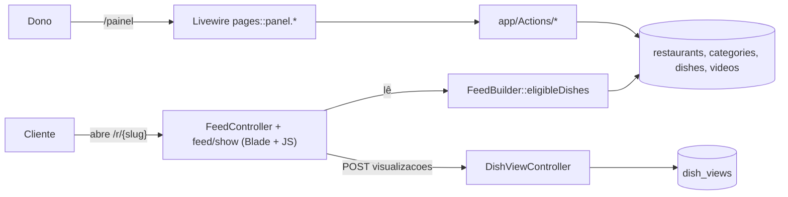
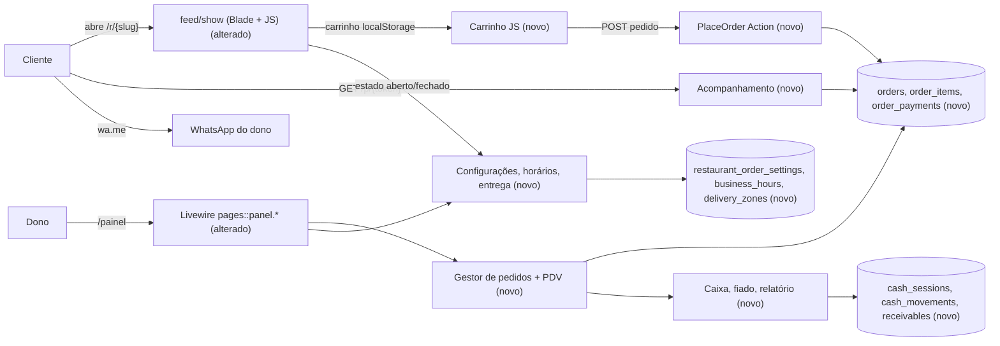

# SPEC: pedidos-caixa-degusta

## Metadata
- Source: developer description via /plan
- Service: cardapio (Laravel 13, Livewire 4, Pest; repositório único)
- Tier: complete
- Version: 1.1
- Architecture references: `docs/agents/architecture.md`, `docs/agents/domain_rules.md`, `docs/agents/coding_guidelines.md`, `docs/agents/data_model.md`, `docs/agents/api_contracts.md` (`AGENTS.md` é apenas stub do Boost)
- Planning source: `Docs/planejamento-pedidos-e-caixa.md` (seções 3, 3.1, 5, 6, 7, 8)

## Context
O Degusta hoje é um cardápio em vídeo somente de visualização (feed `/r/{slug}`, aparência, QR, billing Stripe, suporte, admin Filament). Esta SPEC guarda-chuva (fases 0 a 7) o transforma em cardápio + pedidos + entrega + caixa, sem regredir o existente.

Decisões do desenvolvedor: pedidos em todos os planos (planos diferem por vídeo, limite de pratos e métricas); sem pagamento online (Pix direto para a conta do dono, conferido no app do banco); rótulo "Pratos" vira "Produtos" no painel, `dishes` permanece no código.

Regras de arquitetura citadas (docs/agents):
- `architecture.md`: controllers/páginas Livewire finos delegam a Actions de propósito único; Livewire pages não possuem lógica de persistência; feed é Blade + JS puro, sem Livewire.
- `coding_guidelines.md`: Actions em `app/Actions/<Área>/<Verbo>.php` com `handle()`, `DB::transaction` e `lockForUpdate()` para saldos; operações de dinheiro idempotentes via `reference`; status/tipos como tabelas lookup (`IsLookupTable`, `LookupSeeder`) resolvidas por slug; testes Pest com `RefreshDatabase`.
- `domain_rules.md`: elegibilidade do feed (`FeedBuilder::eligibleDishes`), `Restaurant::canAddDish()`, retenção via comandos agendados (`videos:prune`).
- `api_contracts.md`: sem `routes/api.php`; tudo em `routes/web.php`; endpoint público do feed usa throttle (`POST /r/{slug}/visualizacoes`, throttle 120,1); worker roda `--tries=1`, sem retry configurado.

Pontos do código verificados: `App\Support\Money` com `parse`, `brl`, `brlFromCents`, `input` (verified at app/Support/Money.php:10-50); `resources/views/feed/show.blade.php` e `resources/js/feed.js` existem; `PanelNavigation` em `app/Support/PanelNavigation.php`; tabela `coupons` é da plataforma (billing), portanto cupons do restaurante usam `promo_codes`. `docs/agents/project_overview.md` e o README afirmam "só de visualização" e devem ser atualizados.

## AS IS — Estado atual

O cliente apenas visualiza o feed em vídeo e reporta watch-time. O dono gerencia pratos, aparência, QR, assinatura e suporte pelo painel Livewire; não existe pedido, entrega, horário ou caixa.

## TO BE — Estado proposto

Nós novos realizam: configurações/horário (RF-01, RF-02, UI-01), carrinho e `PlaceOrder` (RF-03 a RF-06, CT-01, CT-02), acompanhamento (RF-07, CT-03), gestor (RF-08, UI-03), caixa e fiado (RF-09 a RF-12), PDV (RF-13). Produtos avançados, crescimento e operação (RF-14 a RF-24) estendem os mesmos agregados.

## Scope
- **In**: fases 0 a 7 do planejamento: configurações e horário; complementos, carrinho, checkout, pedido e WhatsApp; gestor de pedidos; caixa, fiado, relatório; PDV; pizza, kg, promoção, banner; cupons do restaurante, fidelidade, clientes, origem, funil; motoboys, comanda, guia, ajuda em vídeo, estilos de cardápio, landing, PWA, taxa por distância; atualização de `project_overview.md` e README.
- **Out**: pagamento online (Pix/cartão processado pelo Degusta); integração com a API oficial do WhatsApp (usa-se link `wa.me`); alterações no billing da plataforma e na tabela `coupons`; reescrita do feed em Livewire; qualquer escopo fora dos 12 ACs e do planejamento.

## RIGID (Non-Negotiable)

### Functional Requirements

**Fase 0 — Fundação**
- RF-01 [Event-Driven]: Quando o dono salvar as configurações do restaurante, o sistema deve persistir WhatsApp de pedidos, endereço, chave Pix, titular e cidade do Pix, modo de aceitar pedido fora do horário e ligar/desligar manual da loja.
  - AC: após salvar, reabrir a tela mostra os mesmos valores; número inválido é rejeitado com mensagem; a ação "Testar este número" abre link `wa.me` com mensagem de teste sem criar pedido.
- RF-02 [State-Driven]: Enquanto houver horário configurado por dia da semana (um ou mais turnos, inclusive virando a meia-noite), o servidor deve calcular o estado da loja e o feed deve exibir "Aberto agora" ou "Fechado · abre às X" (X = próxima abertura).
  - AC: com horário seg 18:00-23:00, em seg 19:00 (no fuso da loja, RNF-09) o feed exibe "Aberto agora"; em seg 12:00 exibe "Fechado · abre às 18:00"; com o interruptor manual fechado, exibe fechado independentemente do horário; o painel exibe estado atual e próximo horário.
- RF-02a [Conditional]: Se a loja estiver fechada e "aceitar pedido fechado" estiver desligado, então o servidor deve recusar a criação de pedido (CT-01) com erro 422 e mensagem de loja fechada. Se a loja fechar (ou um produto ficar indisponível) entre montar o carrinho e confirmar, o servidor recusa com mensagem clara indicando qual item saiu ou que a loja fechou, e o cliente edita o carrinho (ver RF-06e). Pedido feito com "aceitar pedido fechado" ligado entra com status "novo" e selo "feito fora do horário".
  - AC: POST de pedido com loja fechada retorna 422; com a opção ligada retorna 201 e o pedido tem o selo "feito fora do horário" visível no gestor; pedido feito com a loja aberta não tem o selo.
- RF-02b [Optional]: Onde uma categoria tiver ícone e janela de horário própria, o feed deve ocultá-la fora da janela e exibir o ícone na categoria e na mensagem de WhatsApp.
  - AC: categoria 11:00-15:00 não aparece às 16:00 e aparece às 12:00.
- RF-02c [Event-Driven]: Quando o dono se cadastrar escolhendo tipo de negócio (lanchonete, pizzaria, marmitaria, açaí, doceria), o sistema deve criar as categorias iniciais do tipo.
  - AC: cadastro com "pizzaria" cria ≥ 1 categoria do conjunto da pizzaria; sem escolha, nenhuma categoria é criada.
- RF-02d [Ubiquitous]: O painel deve rotular "Produtos" onde hoje há "Pratos", agrupar o menu em Cardápio, Pedidos, Financeiro, Divulgação e Conta, e expor flag de funcionalidade por plano.
  - AC: nenhuma tela do painel contém o rótulo "Pratos"; rotas `/painel/pratos*` existentes continuam respondendo 200 (nomes de rota `panel.dishes*` preservados); o menu exibe exatamente os 5 grupos nomeados; uma funcionalidade marcada como não disponível no plano do dono não aparece habilitada (acesso direto retorna 403 ou redireciona ao upgrade).
- RF-02e [Event-Driven]: Quando o dono editar o fuso da loja em Configurações (padrão `America/Porto_Velho`), o sistema deve usá-lo em todas as regras de horário (RNF-09).
  - AC: ver RNF-09.

**Fase 1 — Cliente pede**
- RF-03 [Event-Driven]: Quando o dono cadastrar grupos de complementos (nome, modo um/vários, máximo de escolhas, obrigatório, permite repetir, opções com preço opcional) e os ligar a um produto, o sistema deve persistir grupos, opções e vínculo, inclusive ao criar o produto.
  - AC: criar produto com 2 grupos e reabrir a edição retorna os 2 grupos; existem 9 modelos prontos de grupo; `dish_variants` continuam funcionando como preço alternativo.
- RF-04 [Event-Driven]: Quando o cliente adicionar produto ao pedido no feed, o carrinho (JS puro, `localStorage` por loja) deve registrar produto, variação, complementos com quantidade e observação de até 140 caracteres, e exibir barra fixa "Ver pedido · N itens · R$ total".
  - AC: grupo obrigatório sem escolha bloqueia adicionar; observação com 141 caracteres é bloqueada; o feed continua sem Livewire.
- RF-05 [Event-Driven]: Quando o cliente confirmar o checkout, o servidor deve recalcular todos os preços (produto, variação, complementos, taxa, desconto, total) a partir do banco e ignorar valores enviados pelo navegador.
  - AC: payload com preço adulterado produz pedido com o total recalculado pelo servidor; item inexistente, indisponível ou de outra loja resulta em 422.
- RF-06 [Event-Driven]: Quando o servidor aceitar o pedido, deve gravá-lo com código curto único por loja (ex.: `D-X6ECG`), `tracking_token` único, status "novo", snapshot dos itens (nome, preço, escolhas) e mensagem de WhatsApp pronta com itens, escolhas, subtotal, taxa, total, recebimento, pagamento (e troco), endereço e link `/p/{token}`.
  - AC: dois pedidos nunca compartilham código na mesma loja; editar o preço do produto depois não altera o pedido gravado; a mensagem contém o link de acompanhamento.
- RF-06a [Event-Driven]: Quando o cliente abrir o WhatsApp, o sistema deve gravar `whatsapp_opened_at`; quando responder "Sim, enviei" à pergunta de confirmação, gravar `customer_confirmed_at`; "Ainda não" não grava confirmação.
  - AC: timestamps ficam nulos até o evento correspondente e o gestor exibe os selos.
- RF-06b [Conditional]: Se o cliente escolher entrega, então o checkout deve aplicar taxa do bairro (`delivery_zones`); para bairro fora da lista a entrega é permitida com taxa "a combinar" (o dono define a taxa ao aceitar, RF-08); frete grátis acima do valor configurado e pedido mínimo para entrega. O mínimo e o limite de frete grátis são avaliados sobre o subtotal dos produtos antes de desconto/cupom. Abaixo do mínimo só retirada é permitida.
  - AC: subtotal (antes de desconto/cupom) abaixo do mínimo bloqueia entrega (422 no servidor), mesmo que o cupom reduza ou não o total; subtotal acima do mínimo com cupom que leve o total abaixo do mínimo continua permitido; acima do limite de frete grátis a taxa é 0,00; bairro fora da lista cria pedido de entrega com taxa "a combinar" (sem 422); a UI mostra "faltam R$ X para entrega grátis".
- RF-06c [Event-Driven]: Quando o cliente escolher a forma de pagamento, o checkout deve oferecer Pix, dinheiro (com troco para valor ≥ total) e cartão débito/crédito na entrega; para Pix exibe copia e cola com o valor do pedido. O Pix nunca marca o pedido como pago automaticamente: o dono confere no app do banco e confirma o pagamento ao finalizar (RF-09).
  - AC: troco menor que o total é rejeitado; payload Pix contém o valor total calculado pelo servidor; pedido com Pix criado pelo CT-01 e avançado até "pronto/em rota" não gera `order_payments` nem movimento de caixa até o dono finalizar e confirmar.
- RF-06d [Optional]: Onde o aparelho permitir, o checkout deve salvar nome, WhatsApp e endereço no `localStorage` com aviso de privacidade e oferecer "Fazer outro pedido" após o envio.
  - AC: segundo checkout no mesmo aparelho vem preenchido.
- RF-06e [Unwanted]: Se o produto estiver esgotado, oculto ou fora do horário da categoria, então o sistema não deve permitir adicioná-lo nem aceitá-lo no servidor. Se isso ocorrer entre montar o carrinho e confirmar, o servidor recusa o pedido inteiro com 422 e mensagem que identifica qual(is) item(ns) saiu(íram); o pedido não é criado e o cliente edita o carrinho.
  - AC: pedido contendo produto oculto retorna 422; o corpo do 422 lista o nome/id de cada item indisponível; produto que ficou indisponível após ser adicionado ao carrinho resulta em 422 sem criar `orders`; após remover o item o mesmo carrinho é aceito (201).
- RF-06f [Ubiquitous]: O painel deve listar produtos com busca, filtro por categoria, abas Todos/Ativos/Indisponíveis/Ocultos, edição de preço na linha, interruptores disponível/visível, duplicar e excluir, e política de privacidade por loja em `/privacidade?loja={slug}`.
  - AC: preço colado em formato "R$ 32,90", "32,90" ou "3290" é interpretado por `Money::parse` no servidor.
- RF-07 [State-Driven]: Enquanto o token for válido, a página `/p/{token}` deve exibir linha do tempo com horário de cada etapa, tema da loja, botão "Falar com a loja" e "Ver cardápio", e atualizar sozinha por polling.
  - AC: mudança de status no gestor aparece na página em ≤ 15 s sem recarregar; token inexistente retorna 404; a página não expõe dados de outro pedido.
- RF-07a [Conditional]: A página `/p/{token}` e o JSON de status devem exibir apenas o primeiro nome do cliente e endereço parcial (bairro e rua, sem número/complemento), e o token expira 7 dias após o fim do pedido (finalizado, recusado ou cancelado). A mensagem de WhatsApp leva o mesmo link, portanto a regra vale para ela.
  - AC: a resposta HTML e a de `/p/{token}/status` não contêm sobrenome, WhatsApp, número do endereço nem observações; `/p/{token}` de pedido encerrado há 8 dias retorna 404 (ou 410) e há 6 dias retorna 200.

**Fase 2 — Gestor**
- RF-08 [Event-Driven]: Quando o dono acionar uma ação no gestor (aceitar, recusar, em preparo, saiu para entrega/pronto, finalizar, cancelar), o sistema deve atualizar o status, gravar `order_status_history` e permitir avisar o cliente por WhatsApp com mensagem pronta. Transições válidas: novo → aceito | recusado; aceito → em preparo; em preparo → pronto/em rota; pronto/em rota → finalizado; finalizado → cancelado (somente com motivo obrigatório, ver RF-08c). `recusado` e `cancelado` são terminais.
  - AC: transições inválidas (ex.: finalizar pedido recusado, cancelar pedido recusado) são rejeitadas; cada transição cria 1 linha de histórico; aceitar pedido "a combinar" exige definir a taxa.
- RF-08c [Event-Driven]: Quando o dono cancelar um pedido finalizado informando o motivo, o sistema deve, numa única transação idempotente: gravar o motivo no histórico; lançar movimento de estorno no caixa (sem apagar o movimento original); devolver o selo de fidelidade (RF-18); devolver o uso do cupom (RF-17); e cancelar o fiado vinculado se ainda não pago.
  - AC: cancelar sem motivo é rejeitado; cancelar com motivo cria 1 movimento de estorno de valor igual ao recebido em dinheiro e mantém o movimento de venda original; cancelar duas vezes não duplica estorno, selo nem devolução de cupom; fiado já pago não é cancelado e o estorno do valor pago é registrado; fiado não pago fica cancelado e sai do total a receber.
- RF-08a [Event-Driven]: Quando chegar pedido novo, o gestor deve atualizar sem recarregar, tocar som e incrementar o contador no menu.
  - AC: pedido criado via CT-01 aparece em ≤ 10 s; contador reflete pedidos em status "novo".
- RF-08b [Ubiquitous]: O gestor deve exibir 4 colunas (Novos, Em preparo, Pronto/Em rota, Finalizados), busca, filtro hoje/ontem/7 dias e soma do período, e só mostrar pedidos da própria loja.
  - AC: dono da loja A não acessa pedidos da loja B (403/404).

**Fase 3 — Caixa**
- RF-09 [Event-Driven]: Quando o dono finalizar um pedido, o sistema deve registrar o pagamento como Pix (confirmado pelo dono, RF-06c), dinheiro (com troco calculado), cartão, fiado, dividido (soma dos pagamentos = total) ou "finalizar sem registrar". Com o caixa fechado o dono PODE finalizar pedido de delivery; nesse caso o pagamento é registrado no pedido, mas só vira movimento de caixa se houver caixa aberto, e a tela exibe aviso de que não houve lançamento no caixa.
  - AC: dividido com soma ≠ total é rejeitado; fiado cria registro em `receivables` com nome e WhatsApp; pagamento é editável após finalizar; finalizar duas vezes não duplica movimentos (idempotência por referência); finalizar pedido de delivery com caixa fechado retorna sucesso, cria `order_payments`, não cria `cash_movements` e exibe o aviso; o mesmo fluxo com caixa aberto cria o movimento.
- RF-10 [Event-Driven]: Quando o dono abrir o caixa informando o troco inicial, o sistema deve permitir lançar despesa (com categoria), retirada e reforço, e, ao fechar, comparar o dinheiro contado com o esperado e exibir a diferença. O "esperado na gaveta" considera somente dinheiro; Pix e cartão aparecem à parte no relatório de fechamento.
  - AC: esperado = troco inicial + vendas em dinheiro + reforços − retiradas − despesas em dinheiro − estornos em dinheiro (RF-08c); vendas em Pix e cartão não alteram o esperado e são listadas em linhas separadas no fechamento; não pode haver 2 caixas abertos por loja; pedido finalizado com caixa aberto gera movimento de venda sozinho.
- RF-11 [Event-Driven]: Quando o dono registrar baixa de um fiado, o sistema deve marcar `paid_at` e lançar a entrada no caixa aberto; a lista exibe total a receber.
  - AC: total a receber = soma dos fiados sem `paid_at`.
- RF-12 [Event-Driven]: Quando o dono escolher um período (hoje, ontem, 7 dias, mês, mês passado), o relatório deve exibir vendas, ticket médio, recebido, despesas e resultado.
  - AC: resultado = recebido − despesas; totais batem com a soma dos movimentos do período.

**Fase 4 — PDV**
- RF-13 [Event-Driven]: Quando o operador concluir uma venda de balcão, o sistema deve criar pedido com canal `pdv`, aplicar desconto e nome do cliente, enviar para a cozinha (status "Em preparo") e cobrar com troco no mesmo caixa aberto.
  - AC: venda de balcão aparece no caixa e no relatório junto com delivery; sem caixa aberto a cobrança é bloqueada (diferente do delivery, RF-09: o PDV sempre exige caixa aberto) e nenhum pedido `pdv` é criado.

**Fase 5 — Produtos avançados**
- RF-14 [Event-Driven]: Quando o dono publicar uma pizza (tamanhos com fatias e máximo de sabores; sabores com seção e ingredientes; preço por sabor e tamanho), o sistema deve salvar tudo numa única transação e bloquear publicação sem ao menos um sabor com preço.
  - AC: criar e reler pizza retorna tamanhos, sabores e preços; sem sabor com preço a publicação falha.
- RF-14a [Conditional]: Se a pizza for meio a meio, então o preço deve seguir a regra configurada (`maior` = sabor mais caro, `media` = média dos sabores).
  - AC: sabores R$ 40 e R$ 60 resultam em R$ 60 (maior) ou R$ 50 (média).
- RF-15 [Event-Driven]: Quando o produto for vendido por kg (passo 0,5 kg), o gestor deve permitir ajustar o valor dos produtos e da taxa separadamente após a pesagem antes de finalizar.
  - AC: ajuste recalcula total e é registrado no pedido.
- RF-16 [State-Driven]: Enquanto houver `promo_price` válido, o feed deve exibir "de R$ X por R$ Y", destaque no topo e banner promocional (título ≤ 70, texto ≤ 140, data limite); após a data limite o banner some.
  - AC: o servidor cobra `promo_price` enquanto vigente e o preço normal depois.

**Fase 6 — Crescimento**
- RF-17 [Event-Driven]: Quando o cliente aplicar cupom do restaurante (`promo_codes`: código, % ou R$, mínimo, limite de usos, validade, descrição ≤ 80, via código ou link), o servidor deve validar e recalcular o total.
  - AC: cupom expirado, abaixo do mínimo ou esgotado é rejeitado; `uses` incrementa só quando o pedido é criado; cancelar o pedido (RF-08c) decrementa `uses` em 1, uma única vez, nunca abaixo de 0; o desconto não reduz o subtotal usado para mínimo de entrega/frete grátis (RF-06b); a tabela `coupons` da plataforma não é alterada.
- RF-18 [Event-Driven]: Quando o pedido for finalizado e atingir o mínimo do programa, o sistema deve creditar 1 selo no cartão fidelidade; quando for cancelado, os selos voltam; ao completar, o prêmio (% , R$ ou brinde) é resgatável uma vez.
  - AC: finalizar duas vezes credita 1 selo; cancelar um pedido finalizado (RF-08c) devolve o selo uma única vez; cancelar duas vezes não devolve 2.
- RF-19 [Event-Driven]: Quando o dono acionar "Apagar dados" de um cliente, o sistema deve remover os dados pessoais do cliente; clientes sem pedido há 2 anos devem ser expurgados por comando agendado.
  - AC: após apagar, nome e WhatsApp do cliente não existem mais no banco; pedidos mantêm apenas dados anonimizados; o comando agendado remove só registros com último pedido > 2 anos.
- RF-20 [Event-Driven]: Quando o cliente abrir o cardápio por link com `?origem=` (anúncio, Instagram, WhatsApp, Facebook, QR) e nome de campanha, o pedido deve guardar a origem, e o relatório deve mostrar vendas por origem.
  - AC: pedido criado após visita com `?origem=instagram` grava `origin=instagram`; valor desconhecido grava "outro".
- RF-21 [Event-Driven]: Quando o cliente avançar no funil (visitou, adicionou, iniciou checkout, WhatsApp abriu, confirmou), um endpoint público com throttle deve registrar o evento. O painel exibe, em todos os planos, contadores simples (pedidos, vendas, origem). Funil (taxas entre etapas), rankings (mais vistos/adicionados/pedidos, complementos mais escolhidos) e horário de pico ficam disponíveis apenas para planos cujo `metrics_level` seja `por_prato` ou `por_prato_com_tempo_assistido` (MetricsLevelSeeder/PlanSeeder); o plano com `cardapio_total` vê somente os contadores simples.
  - AC: evento duplicado na mesma sessão não infla a contagem; endpoint responde 204 e usa throttle; dono de plano `cardapio_total` não vê funil, rankings nem horário de pico (acesso direto retorna 403 ou bloco de upgrade) mas vê os contadores simples; dono de plano `por_prato` ou superior vê todos.

**Fase 7 — Operação e acabamento**
- RF-22 [Event-Driven]: Quando o dono atribuir um motoboy a um pedido (cadastro com nome, WhatsApp e valor por entrega ajustável), o sistema deve contar a entrega; ao fechar o acerto, o valor deve entrar sozinho como despesa do caixa e o entregador acessa por link com token apenas os pedidos dele em rota do dia para marcar "entregue". O dono pode revogar o link do motoboy.
  - AC: fechar acerto 2 vezes lança 1 despesa; token de um motoboy não lê pedidos de outro; o link lista só pedidos atribuídos a ele com status "em rota" no dia (pedido de ontem ou já entregue não aparece); após o dono revogar, `GET /entregador/{token}` retorna 404 (ou 403) e o token antigo não volta a funcionar; o link não expõe WhatsApp completo nem sobrenome do cliente além do necessário à entrega (primeiro nome, endereço e valor a cobrar).
- RF-23 [Event-Driven]: Quando o dono imprimir a comanda, o sistema deve gerar versão para 58 ou 80 mm, com comanda de teste e opções "imprimir ao aceitar" e "imprimir novos automaticamente" guardadas por aparelho, ou seja, no `localStorage` do navegador do aparelho (não no banco, não por loja/usuário).
  - AC: a impressão contém código, itens, escolhas, observações e endereço; as duas opções persistem após recarregar no mesmo aparelho e não afetam outro aparelho/navegador do mesmo dono; nenhuma coluna de banco guarda essas opções.
- RF-24 [Ubiquitous]: O produto deve oferecer guia de 9 passos com % de conclusão, central de ajuda em vídeo com busca, estilos de cardápio (Vidro, Claro, Rústico) escolhidos em Aparência com preview ao vivo e PWA do painel com menu "Mais" no mobile (itens de acabamento listados em RF-24a a RF-24c).
  - AC: 9 passos listados, % = passos concluídos / 9; estilos aplicam-se ao feed sem quebrar o preview existente; busca de ajuda retorna vídeos por termo; o manifesto PWA é válido e o menu "Mais" aparece em viewport ≤ 640 px.
- RF-24a [Conditional]: Se o dono ativar a taxa por distância, então o checkout deve calcular a taxa de entrega pela distância entre a loja e o endereço do cliente segundo faixas configuradas (km inicial, km final, valor), em vez de `delivery_zones`; endereço sem distância calculável ou além da maior faixa cai em "a combinar" (RF-06b). Com a opção desligada vale a taxa por bairro.
  - AC: com faixas 0-3 km = R$ 5,00 e 3-6 km = R$ 8,00, endereço a 4 km tem taxa R$ 8,00 calculada no servidor; endereço a 7 km ou sem distância resulta em "a combinar"; com a opção desligada a taxa é a do bairro; valor enviado pelo navegador é ignorado (RF-05).
- RF-24b [Ubiquitous]: A landing deve exibir comparativo de mensagens e calculadora de comissão.
  - AC: a landing contém as duas seções; a calculadora retorna comissão = faturamento × percentual informado.
- RF-24c [Ubiquitous]: `docs/agents/project_overview.md` e o README não devem afirmar "só de visualização".
  - AC: `grep -i "só de visualização"` nesses dois arquivos retorna 0 ocorrências.
- RF-25 [Ubiquitous]: Nada do que existe hoje deve regredir.
  - AC: `./vendor/bin/sail artisan test` mantém todos os testes anteriores passando ao fim de cada fase; rotas existentes listadas em `api_contracts.md` seguem respondendo.

### UI Requirements
- UI-01 [Ubiquitous]: As telas novas do painel devem ser Livewire (`pages::panel.*`), usar componentes de `components/ui`, e entrar em `PanelNavigation` agrupadas.
  - AC: cada tela nova é alcançável pelo menu e pela rota nomeada.
- UI-02 [Ubiquitous]: Carrinho, checkout em etapas (receber → endereço → pagamento → observação) e `/p/{token}` devem herdar cor, fonte e estilo de vidro do feed.
  - AC: tema da loja aplicado nas 3 telas; checkout usável em viewport 360 px de largura.
- UI-03 [Event-Driven]: Quando houver pedido novo, o gestor deve emitir aviso sonoro; o navegador pode bloquear autoplay, então o painel deve oferecer ativar o som.
  - AC: som toca após o dono ativar o som; sem ativação, o contador visual ainda atualiza.
- UI-04 [State-Driven]: Enquanto a loja estiver fechada, o painel deve exibir aviso destacado com o estado atual e o próximo horário.
  - AC: aviso visível quando RF-02 resulta fechado.

### Contracts
- CT-01: `POST /r/{restaurant:slug}/pedidos` (novo, sem login, throttle; a rota é verificada contra colisão com `routes/web.php` na fase de plano, antes de implementar). Entrada: itens (id, variação, escolhas, quantidade/peso, observação), recebimento, endereço, pagamento, troco, cupom, origem, nome e WhatsApp. Respostas: 201 com `code`, `tracking_token`, mensagem de WhatsApp e URL; 403 loja suspensa; 422 validação/loja fechada/mínimo/item indisponível (corpo identifica o item).
- CT-02: `POST /r/{slug}/pedidos/{token}/whatsapp` (novo) registra `whatsapp_opened_at` e `customer_confirmed_at`; 204.
- CT-03: `GET /p/{token}` (novo, público; HTML com polling por endpoint JSON `GET /p/{token}/status`); 404 se inexistente ou expirado (7 dias após o fim do pedido). Exibe só primeiro nome e endereço parcial (RF-07a).
- CT-04: `POST /r/{slug}/eventos` (novo, funil, throttle, 204).
- CT-05: `GET /entregador/{token}` (novo, link do motoboy; revogável pelo dono; mostra só os pedidos em rota do dia do motoboy; 404 se revogado ou inexistente; RF-22).
- CT-06: rotas do painel (novas, middleware `auth, auth.session, owner, verified.owner`): `/painel/configuracoes`, `/painel/complementos`, `/painel/pedidos`, `/painel/caixa`, `/painel/pdv`, `/painel/fiado`, `/painel/relatorio`, `/painel/clientes`, `/painel/cupons`, `/painel/fidelidade`, `/painel/motoboys`, `/painel/ajuda`. [Os caminhos listados são os adotados; o plano apenas confirma ausência de colisão com `routes/web.php` — nenhum existe hoje, verificado com Grep. Nomes de rota seguem `panel.*`.]
- Tabelas novas (nomes do planejamento seção 6): `restaurant_order_settings`, `business_hours`, `delivery_zones`, `option_groups`, `options`, `dish_option_group`, `pizza_sizes`, `pizza_flavors`, `pizza_flavor_prices`, `orders`, `order_items`, `order_payments`, `order_status_history`, `customers`, `cash_sessions`, `cash_movements`, `receivables`, `promo_codes`, `loyalty_programs`, `loyalty_cards`, `couriers`, `promo_banners`; colunas novas em `dishes` (`sale_type`, `kind`, `promo_price`, `is_featured`).

### Non-Functional Requirements
- RNF-01: Todo dado novo carrega `restaurant_id` e é protegido por policy; acesso entre lojas retorna 403/404 (teste por área).
- RNF-02: Valores monetários em `decimal(…,2)` com `App\Support\Money`; totais sempre calculados no servidor; nenhuma soma de dinheiro em float.
- RNF-03: Status, formas de pagamento e tipos de movimento como tabelas lookup (`IsLookupTable`, `LookupSeeder`), resolvidas por slug.
- RNF-04: Operações de dinheiro e saldo (finalizar, baixa de fiado, acerto, selos, cupom `uses`) são idempotentes por referência e executam em `DB::transaction` com `lockForUpdate()`; não dependem de retry de fila (worker `--tries=1`).
- RNF-05: Endpoints públicos (CT-01 a CT-04) têm throttle; resposta do CT-01 em p95 < 800 ms com pedido de até 30 itens.
- RNF-06: O feed permanece sem Livewire; carrinho em JS puro e adição do carrinho não aumenta o JS inicial do feed em mais de 30 KB gzip.
- RNF-07: Cada fase termina com testes Pest passando (um arquivo de feature por área) e nenhum e-mail/WhatsApp real em desenvolvimento/testes.
- RNF-08: Dados pessoais: um comando agendado (padrão `videos:prune`) apaga endereço e observações do cliente 30 dias após o pedido ser finalizado, recusado ou cancelado (conforme aviso de privacidade); nome, WhatsApp e valores permanecem até "Apagar dados" ou 2 anos (RF-19). Pedidos antigos deixam de exibir o endereço.
  - AC: pedido encerrado há 31 dias tem endereço e observações nulos após rodar o comando; pedido encerrado há 29 dias os mantém; pedido ainda aberto nunca é afetado; nome, WhatsApp e valores permanecem; rodar o comando duas vezes é inofensivo; gestor, comanda e relatório não exibem endereço de pedido já expurgado.
- RNF-09: Fuso horário: um fuso por loja (campo em Configurações, padrão `America/Porto_Velho`, editável). O app permanece em UTC (`config/app.php`); a conversão ocorre na camada de apresentação e nas regras de horário (aberto/fechado, caixa, "hoje/ontem", horário de categoria, relatório por período).
  - AC: loja com fuso `America/Porto_Velho` (UTC-4) e horário 18:00-23:00: às 22:30 UTC de segunda (18:30 local) está "Aberto agora" e às 03:30 UTC de terça (23:30 local de segunda) está fechada; pedido criado às 02:00 UTC de terça (22:00 local de segunda) aparece em "hoje" de segunda no relatório e no gestor; fuso inválido é rejeitado ao salvar; `config('app.timezone')` continua `UTC`.

## FLEXIBLE (Implementation Suggestions)
- Actions por área: `app/Actions/Orders/PlaceOrder`, `AdvanceOrder`, `FinalizeOrder`; `Actions/Cash/OpenCashSession`, `CloseCashSession`, `RecordMovement`; `Actions/Menu/SyncDishOptionGroups`; Livewire pages apenas delegam.
- Serviço `Services/Orders/OrderPricer` compartilhado entre feed, PDV e ajuste de kg; `Services/Orders/WhatsAppMessageBuilder`; `Support/BusinessHours` para o estado aberto/fechado.
- Polling de `/p/{token}/status` a cada 10 s; gestor com `wire:poll` ou eventos Livewire.
- Código do pedido: prefixo + 5 caracteres alfanuméricos sem ambíguos, índice único (restaurant, code).
- Eventos do funil reaproveitando o padrão de `dish_views`.
- Ordem de entrega: uma fase por vez, cada uma com testes, conferência em navegador e commit; reiniciar worker (`./vendor/bin/sail restart queue`) após mexer em PHP.

## Acceptance Criteria Summary
| ID | Criterion | Testable? |
|----|-----------|-----------|
| AC-1 | Configurações + horário por dia; feed "Aberto agora"/"Fechado · abre às X" (RF-01, RF-02) | Sim |
| AC-2 | Carrinho no feed, servidor recalcula preços (RF-03 a RF-05) | Sim |
| AC-3 | Retirada/entrega, taxa por bairro, frete grátis, mínimo, Pix/dinheiro/cartão (RF-06b, RF-06c) | Sim |
| AC-4 | Pedido salvo, código único, WhatsApp, "Sim, enviei", `/p/{token}` (RF-06, RF-06a, RF-07) | Sim |
| AC-5 | Gestor em colunas, aceitar/recusar/avançar/avisar, som (RF-08, RF-08a, UI-03) | Sim |
| AC-6 | Pagamento Pix/dinheiro/cartão/fiado/dividido (RF-09) | Sim |
| AC-7 | Caixa, despesa, retirada, reforço, fiado, relatório (RF-10 a RF-12) | Sim |
| AC-8 | PDV no mesmo caixa (RF-13) | Sim |
| AC-9 | Pizza, kg, de/por, banner (RF-14 a RF-16) | Sim |
| AC-10 | Cupons, fidelidade, clientes, origem, funil (RF-17 a RF-21) | Sim |
| AC-11 | Motoboys, comanda, guia, ajuda, estilos, landing (RF-22 a RF-24) | Sim |
| AC-12 | Sem regressão (RF-25) | Sim |

## Distribution by Repo
| Repo | RFs | Contracts |
|------|-----|-----------|
| cardapio (único) | RF-01 a RF-25 | CT-01 a CT-06 |
